# Configurar Credenciales de Google en n8n utilizando **OAuth 2.0**

Conocimientos previos: [Set up Google Credentials in n8n in 5 minutes (2025)](https://www.youtube.com/watch?v=3Ai1EPznlAc)

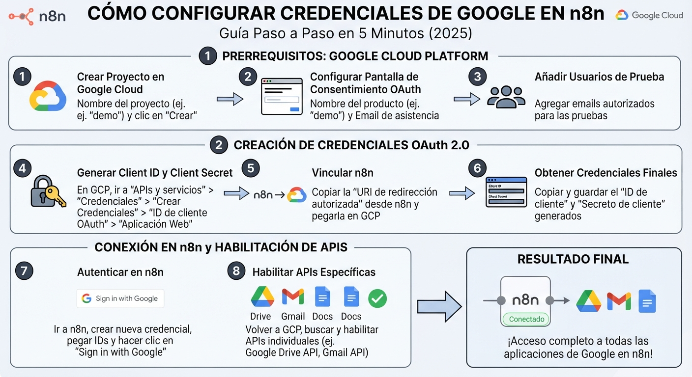

La consola de Google Cloud (**Google Cloud Console**) es el panel de control web que ofrece Google para administrar y gestionar todos los servicios de su plataforma de computación en la nube, conocida como **Google Cloud Platform (GCP)**.

IMPORTANTE:

Hay 2 maneras de autenticacion **Clave de API**  y **OAuth 2.0**:

La diferencia principal radica en qué tipo de recursos controlan y cómo interactúan con tus datos personales:

1) **Clave de API** (Google AI Studio / la de tu imagen): Es una contraseña simple y directa pensada para consumir servicios públicos o modelos de inteligencia artificial (como Gemini). No sabe quién eres tú como persona ni accede a tus archivos personales; solo autoriza al software a usar una herramienta o cuota de IA dentro de un proyecto.

2) **OAuth 2.0** (el que estamos configurando para n8n): Es un protocolo de autorización segura diseñado para acceder a datos privados de usuario (tus documentos de Google Drive, tus correos de Gmail, tus hojas de cálculo, etc.). Requiere que tú (el usuario) inicies sesión explícitamente y des el consentimiento mediante una ventana de autorización (*Sign in with Google*) para que la aplicación externa pueda actuar en tu nombre.

**En resumen:** la Clave de API es para consumir servicios generales o de IA, mientras que el OAuth es obligatorio cuando n8n necesita entrar a tus aplicaciones personales de Google.

**Para crear Clave de API** 

1. Abre una nueva pestaña en tu navegador y entra a: [aistudio.google.com](https://aistudio.google.com)
2. Inicia sesión con la misma cuenta de Google que ya estás usando.
3. En la esquina superior izquierda o en el menú principal, haz clic en el botón que dice **"Get API key"** (Obtener clave de API).
4. Haz clic en **"Create API key in new project"** (Crear clave de API en un proyecto nuevo).
5. ¡Listo! Te aparecerá tu llave secreta en pantalla de forma inmediata. Cópiala.

## Guía Paso a Paso en 5 Minutos (2025) utilizando **OAuth 2.0**

### 🛠️ Fase 1: Prerrequisitos en Google Cloud Platform (GCP)

#### Crear un Proyecto en Google Cloud
1. - Entra a Google Cloud e inicia el proceso para crear un nuevo proyecto.

    https://console.cloud.google.com/

- Asígnale un nombre (por ejemplo, `demo`) y haz clic en **Crear**.
- Asegúrate de seleccionar el proyecto recién creado en la esquina superior de la consola.

2. - Configurar la Pantalla de Consentimiento OAuth

- Seleccionar el proyecto:

  

- En la barra de busqueda escoger (APIs y servicios habilitados):

 

- Seleccionar pantalla de consentimiento (En el menú de navegación de GCP, ve a APIs y servicios > Pantalla de consentimiento OAuth):

 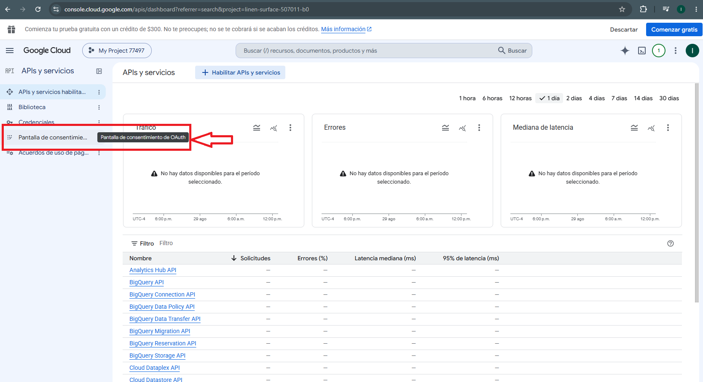

- Seleccionar informacion de la marca (llenar toda la informacion):

  

- Seleccionar clientes:

   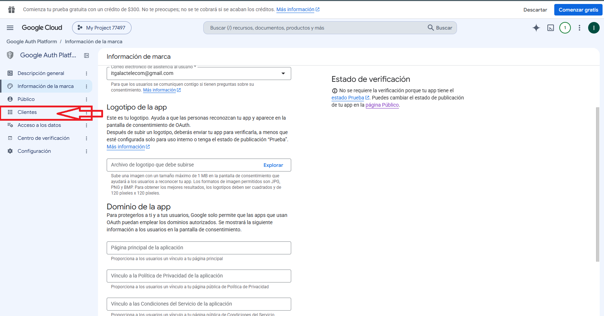

- Crear clientes:

 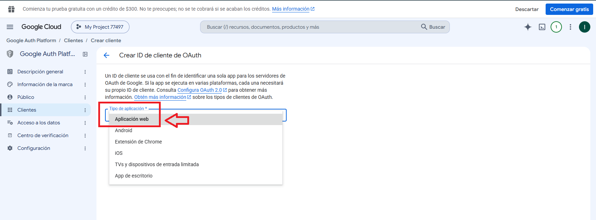

 - Nombre de cliente y click en CREAR:

 

 - Ya queda creado el OUATH:

[Set up Google Credentials in n8n in 5 minutes (2025)](https://www.youtube.com/watch?v=3Ai1EPznlAc)

 

3. - Añadir Usuarios de Prueba

- En la sección de usuarios de prueba, agrega las cuentas de correo electrónico (la tuya) que tendrán permiso para realizar las pruebas y acceder a Google Drive, Docs y Gmail.
- Haz clic en **Guardar y continuar**.

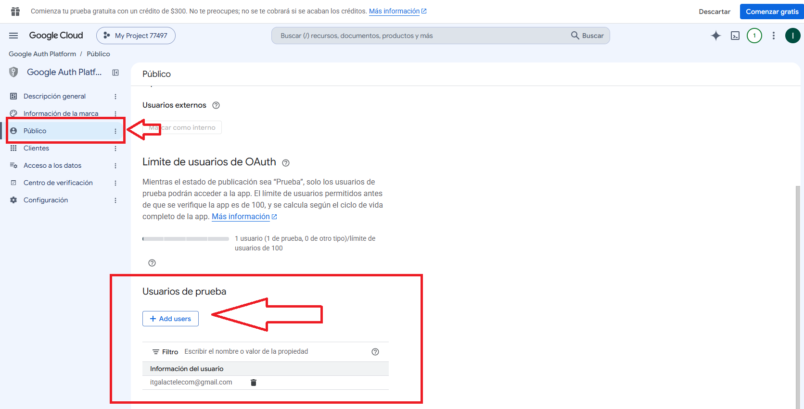

 Para acceder a la configuracion usar el siguiente enlace:

 [Valores de OUATH ](https://console.cloud.google.com/auth/clients?project=linen-surface-507011-b0)

 ### 🛠️ Fase 2: Creacion del Workflow en n8n:

1. Haz clic en el botón con el signo **+** que dice **"Add first step..."** (Añadir primer paso).

 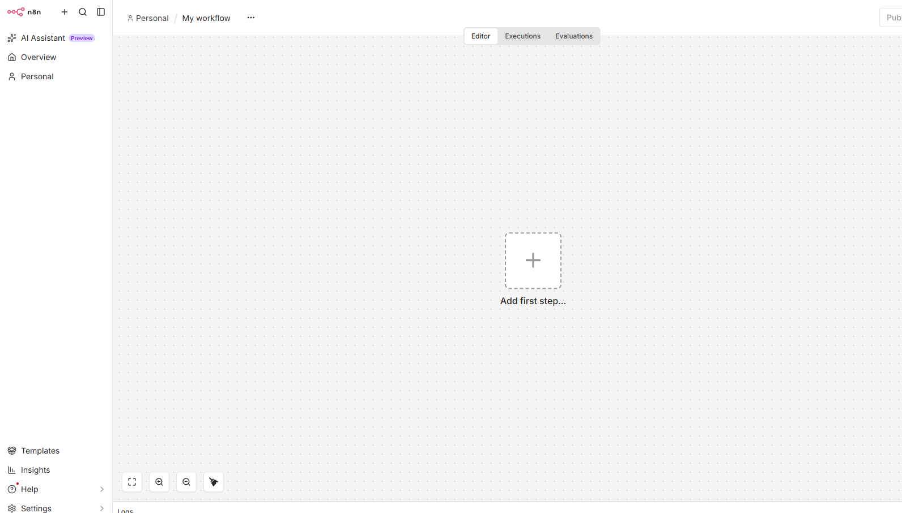

2. Se abrirá un buscador a la derecha. Escribe **Google Drive**.

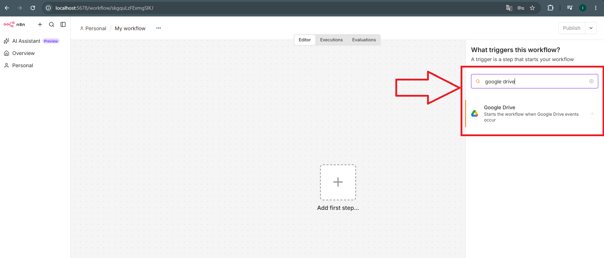

3. Selecciona **Google Drive** de la lista de aplicaciones que aparecen.

4. Una vez que se agregue el nodo, haz doble clic en él o ábrelo, selecciona una acción (por ejemplo, *Upload a file* o *Get a file*), y ahí es donde te pedirá tus credenciales con el botón de **"Sign in with Google"** que ya dejamos preparado.

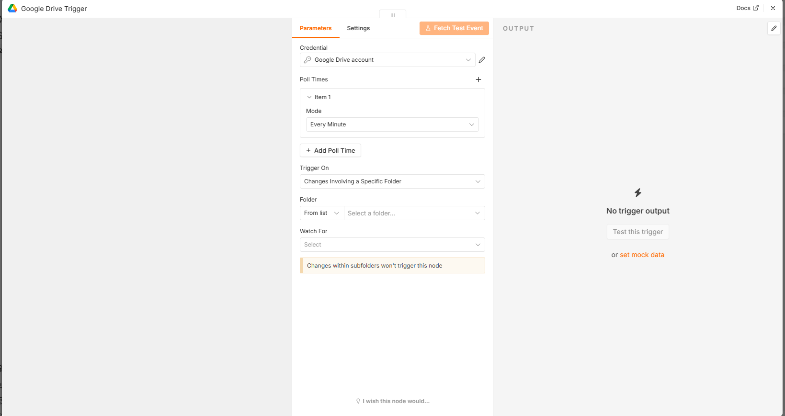

5. Fíjate en la esquina superior derecha de ese panel de configuración: verás un ícono de un lápiz (o editar) al lado del desplegable de la credencial, o bien puedes hacer clic en el nombre de la credencial "Google Drive account" para abrir los detalles de la misma.

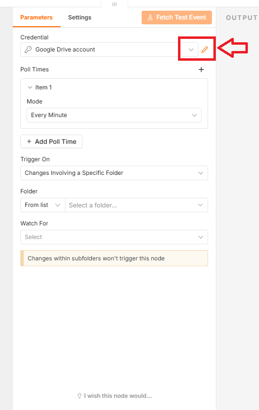

6. Dentro de esa ventana de credenciales, busca y haz clic en el botón "Sign in with Google" que ya conocemos:

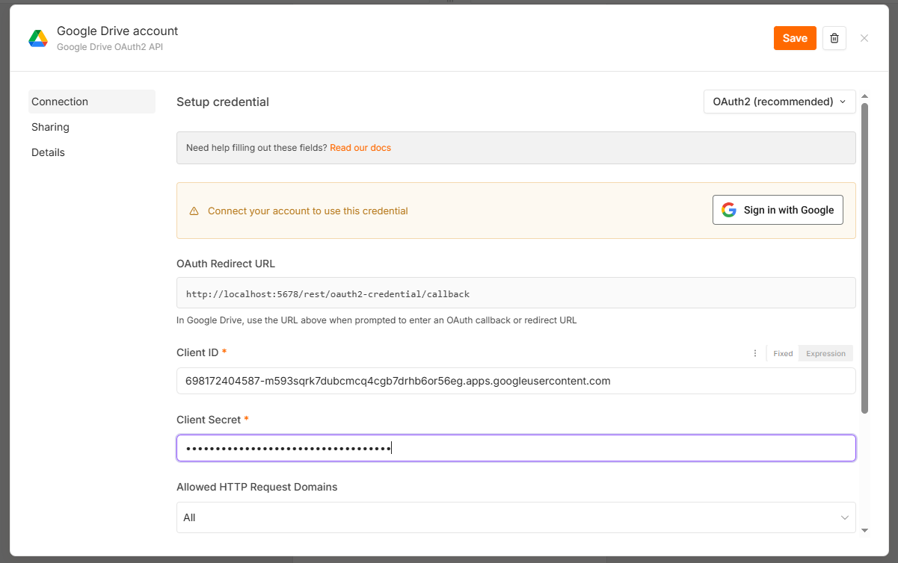

¡Perfecto! Ya tienes colocados los campos más importantes en tu pantalla (el *Client ID* y la *OAuth Redirect URL* ya están puestos correctamente).  

Basándonos en el JSON que acabas de enviar, esto es lo que debes verificar y poner en cada campo de la imagen:

- **OAuth Redirect URL:**  
  Debe ser: `http://localhost:5678/rest/oauth2-credential/callback` (ya lo tienes bien puesto en la imagen).  
- **Client ID:**  
  Copia y pega: `698172404587-m593sqrk7dubcmcq4cgb7drhb6or56eg.apps.googleusercontent.com` (también lo tienes perfecto en la imagen).  
- **Client Secret:**  
  Copia y pega exactamente este valor del JSON: `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` (asegúrate de que esté escrito o pegado correctamente en el campo con los puntos negros).

 7. Siguiente paso:Haz clic en el botón "Save" (Guardar) ubicado arriba a la derecha de esa ventana.  Luego, haz clic en el botón "Sign in with Google" que aparece al centro.  Si te sale la advertencia de que la app no está verificada, dale a Continuar (o Avanzado > Ir a n8n Drive) y acepta los permisos.

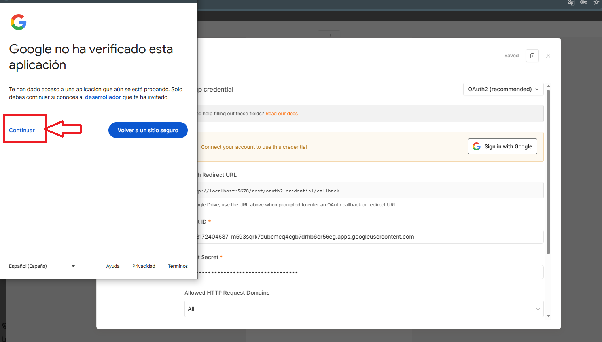

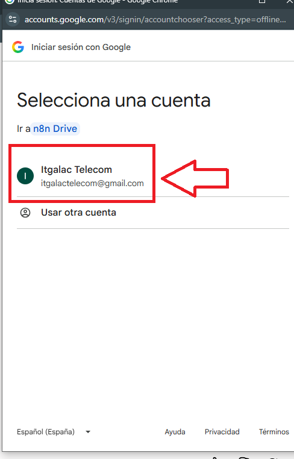

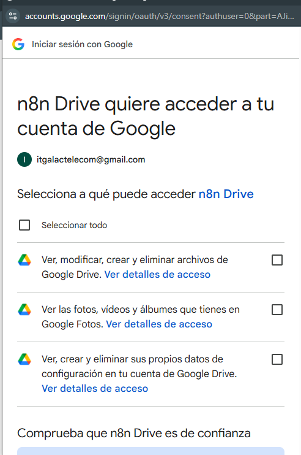

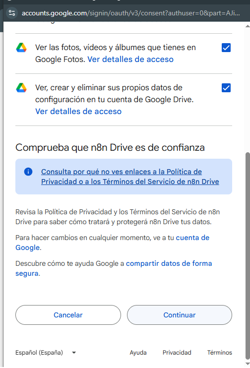

LISTO YA ESTA CONECTADO:

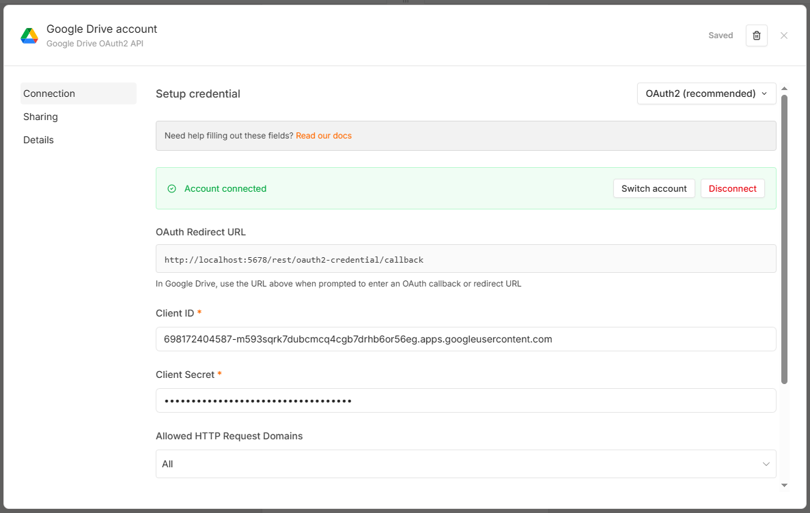

 ### 🛠️ Fase 3: Configurar el la Carpeta y la accion:

 1. Ir al siguiente enlace para poder habilitar:

[Habilitar Google Drive API ](https://console.cloud.google.com/apis/library/drive.googleapis.com?project=linen-surface-507011-b0)

2. Una vez que se abra esa página en Google Cloud, haz clic en el botón azul que dice **"Habilitar"** (*Enable*).

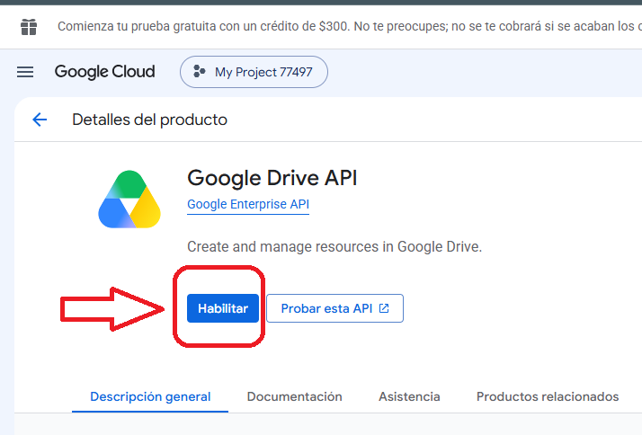

3. Espera un par de minutos a que Google active el servicio en sus servidores.
4. Regresa aquí a n8n, cierra esta ventanita o haz clic en **"Check your credential"**, y vuelve a desplegar la lista de carpetas.

 
