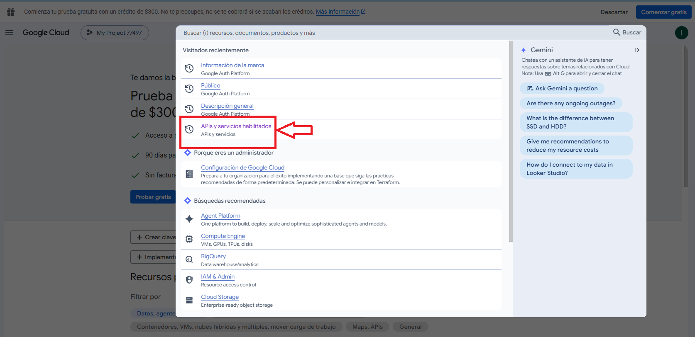

# Cómo Configurar Credenciales de Google en n8n

Conocimientos previos:

La consola de Google Cloud (**Google Cloud Console**) es el panel de control web que ofrece Google para administrar y gestionar todos los servicios de su plataforma de computación en la nube, conocida como **Google Cloud Platform (GCP)**.

## Guía Paso a Paso en 5 Minutos (2025)

### 🛠️ Fase 1: Prerrequisitos en Google Cloud Platform (GCP)

#### Crear un Proyecto en Google Cloud
1. - Entra a Google Cloud e inicia el proceso para crear un nuevo proyecto.

    https://console.cloud.google.com/

- Asígnale un nombre (por ejemplo, `demo`) y haz clic en **Crear**.
- Asegúrate de seleccionar el proyecto recién creado en la esquina superior de la consola.

2. - Configurar la Pantalla de Consentimiento OAuth

- Seleccionar el proyecto:

  

- En la barra de busqueda escoger (APIs y servicios habilitados):

 

- Seleccionar pantalla de consentimiento:

 

- Seleccionar informacion de la marca (llenar toda la informacion):

  

- Seleccionar clientes:

   

- Crear clientes:

 

En el menú de navegación de GCP, ve a APIs y servicios > Pantalla de consentimiento OAuth.

Haz clic en Crear para otorgarle a n8n el permiso de acceder a tu entorno de Google.

Completa los campos básicos solicitados, como el nombre del producto (ej. demo) y un correo electrónico de asistencia.

Haz clic en Guardar y continuar (puedes omitir los Scopes avanzados por ahora haciendo clic nuevamente en continuar).
