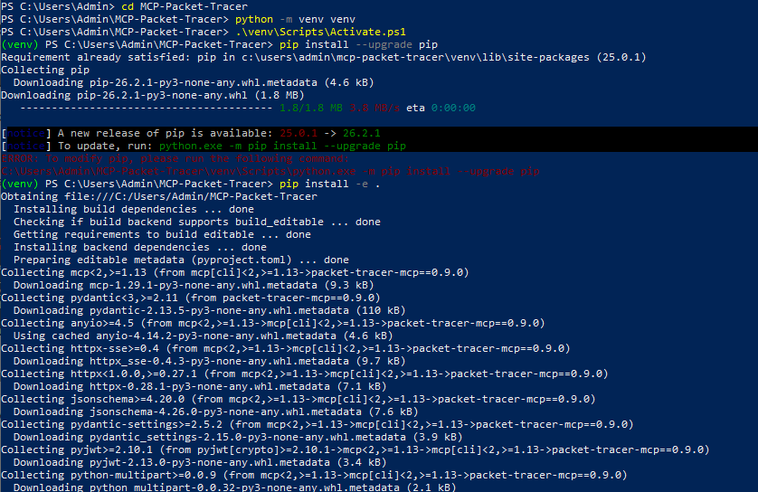
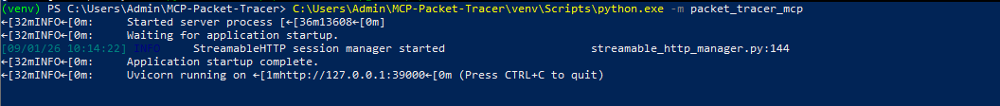
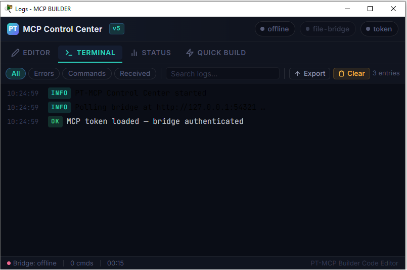

# Integración de MCP con Cisco Packet Tracer y VS Code:

Este documento detalla el paso a paso para configurar la integración de Protocolo de Contexto de Modelo (MCP) entre Cisco Packet Tracer y Visual Studio Code, incluyendo la configuración del entorno de desarrollo local, archivos de seguridad y despliegue de módulos.

## Fase 1: Configuración del Backend y Seguridad

### 1. Clonación del Repositorio Local

Abre una terminal de PowerShell y clona el repositorio oficial del proyecto en tu máquina local:

```text
cd ~
git clone https://github.com/Mats2208/MCP-Packet-Tracer.git
```


### 2. Creación del Entorno Virtual e Instalación de Dependencias:

Entra a la carpeta del proyecto, crea y activa tu entorno virtual de Python, actualiza `pip` e instala el paquete en modo editable (PowerShell):

```text
cd MCP-Packet-Tracer
python -m venv venv
.\venv\Scripts\Activate.ps1
python -m pip install --upgrade pip
pip install -e .
```




### 3. Ejecución del Servidor MCP:

Inicia el servidor basado en Uvicorn para que quede escuchando las peticiones locales (PowerShell):

```text
python -m packet_tracer_mcp
```



> **Nota técnica:** El servidor se mantendrá activo por defecto en [http://127.0.0.1:39000](http://127.0.0.1:39000).

### 4. Generación y Creación del Token de Seguridad

Si intentas iniciar el sistema sin el token de autenticación configurado, verás una alerta de error en los registros de Packet Tracer.



Para solucionarlo, crea manualmente la ruta de directorios local y genera el archivo `bridge_token` ejecutando en PowerShell:

```text
New-Item -ItemType Directory -Force -Path "C:\Users\Admin\AppData\Local\packet-tracer-mcp"
Set-Content -Path "C:\Users\Admin\AppData\Local\packet-tracer-mcp\bridge_token" -Value "token123"
```
