# Integración de MCP con Cisco Packet Tracer y VS Code:

Este documento detalla el paso a paso para configurar la integración de Protocolo de Contexto de Modelo (MCP) entre Cisco Packet Tracer y Visual Studio Code, incluyendo la configuración del entorno de desarrollo local, archivos de seguridad y despliegue de módulos.

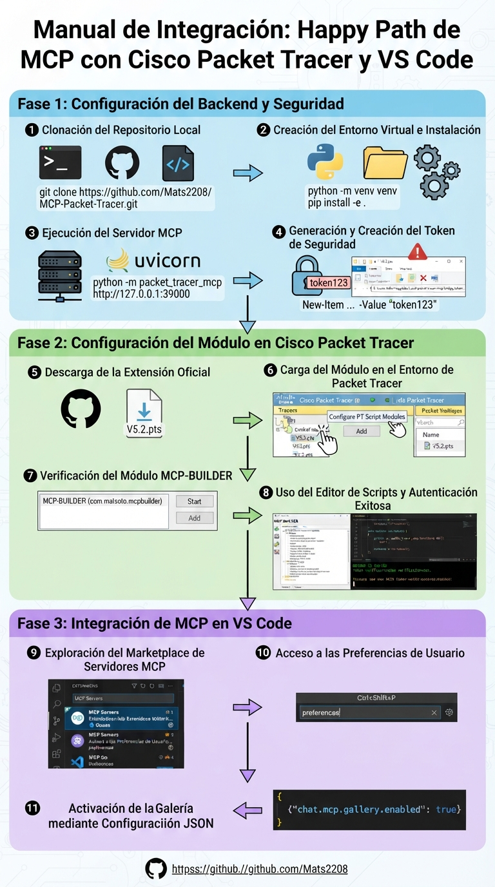

## Fase 1: Configuración del Backend y Seguridad

### 1. Clonación del Repositorio Local

Abre una terminal de PowerShell y clona el repositorio oficial del proyecto en tu máquina local:

```text
cd ~
git clone https://github.com/Mats2208/MCP-Packet-Tracer.git
```
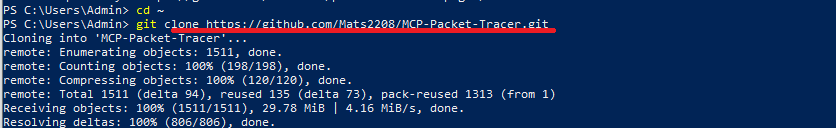

### 2. Creación del Entorno Virtual e Instalación de Dependencias:

Entra a la carpeta del proyecto, crea y activa tu entorno virtual de Python, actualiza `pip` e instala el paquete en modo editable (PowerShell):

```text
cd MCP-Packet-Tracer
python -m venv venv
.\venv\Scripts\Activate.ps1
python -m pip install --upgrade pip
pip install -e .
```


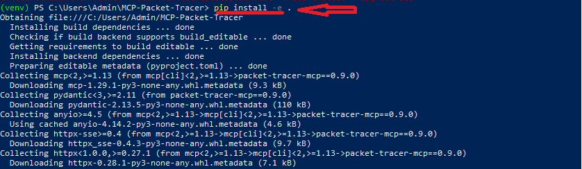

### 3. Ejecución del Servidor MCP:

Inicia el servidor basado en Uvicorn para que quede escuchando las peticiones locales (PowerShell):

```text
python -m packet_tracer_mcp
```


> **Nota técnica:** El servidor se mantendrá activo por defecto en [http://127.0.0.1:39000](http://127.0.0.1:39000).

### 4. Generación y Creación del Token de Seguridad

Tenemos 2 rutas (directorios): 

A) C:\Users\Admin\AppData\Local\packet-tracer-mcp\

Funcion: Sirve como un contenedor seguro y específico de la aplicación para guardar credenciales, configuraciones de conexión o tokens de sesión locales que el script de Python (`packet_tracer_mcp`)  que necesita el servidor de **Model Context Protocol (MCP)** y el módulo dentro de Packet Tracer consultan constantemente para saber cómo comunicarse entre sí.

El path (C:\Users\Admin\AppData\Local\packet-tracer-mcp\) se crea cuando se ejecuta el comando del paso anterior: python -m packet_tracer_mcp

B) C:\Users\Admin\AppData\Local\packet-tracer-mcp\bridge_token.

Este es un archivo de texto plano o de credenciales específico (el token del puente o *bridge token*). Su propósito es actuar como una llave de autenticación local entre el servidor *backend* de Python y el módulo de Packet Tracer (`MCP-BUILDER`).

Con el siguiente comando, se crea la carpeta packet-tracer-mcp en la ruta C:\Users\Admin\AppData\Local\ y luego dentro de esa carpeta se crea el Token "token123"

```text
New-Item -ItemType Directory -Force -Path "C:\Users\Admin\AppData\Local\packet-tracer-mcp"
Set-Content -Path "C:\Users\Admin\AppData\Local\packet-tracer-mcp\bridge_token" -Value "token123"
```

Una vez generado El Token debe visualizarse de la siguiente manera:


Para solucionarlo, 


Al verificar en el Explorador de archivos de Windows, la estructura de directorios y la carpeta interna se visualizarán correctamente.

### 5.Fase 2: Configuración del Módulo en Cisco Packet Tracer:

5. Descarga de la Extensión Oficial (.pts)
Dirígete al repositorio de GitHub y descarga el archivo de la extensión de Packet Tracer correspondiente a la versión oficial requerida (V5.2.pts).

https://github.com/Mats2208/MCP-Packet-Tracer/releases

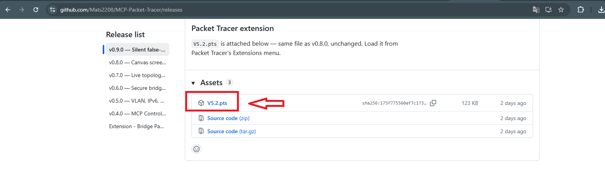

6. Carga del Módulo en el Entorno
Abre Cisco Packet Tracer, dirígete al menú de configuración de scripts de extensión (Configure PT Script Modules), donde verás la lista inicial de módulos nativos.

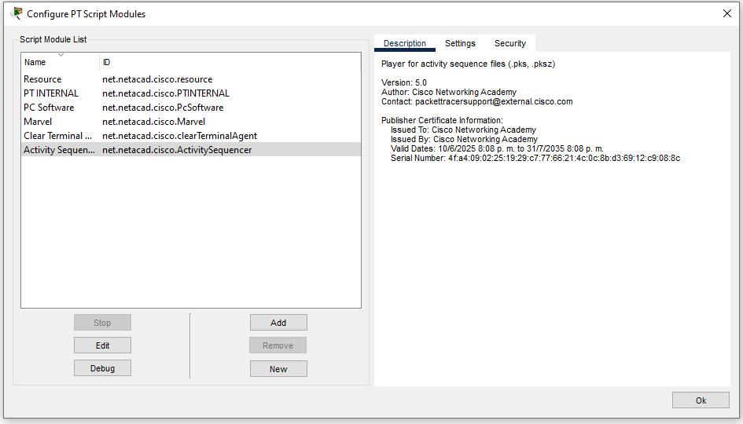

Haz clic en el botón **Add** para abrir el explorador de archivos de Windows y seleccionar el archivo de extensión `.pts`.

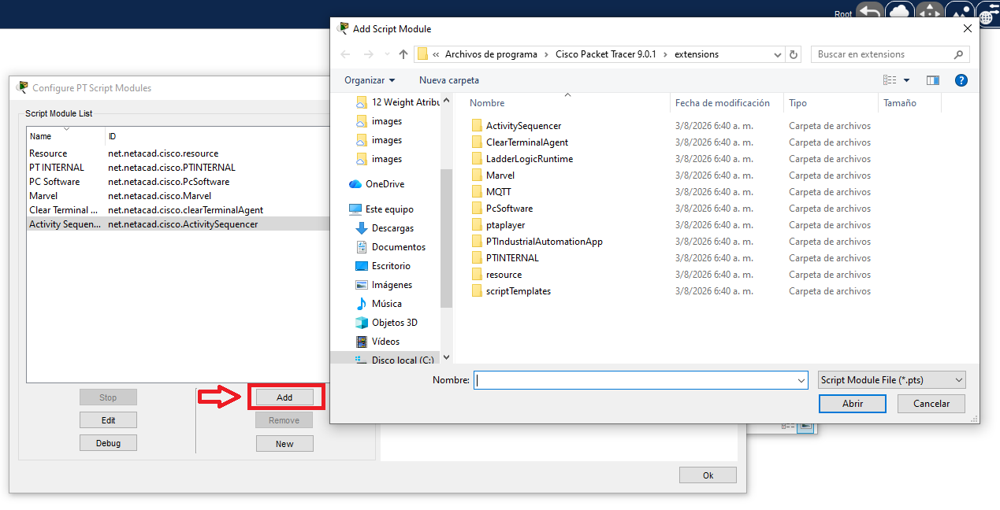

### 7. Verificación e Inicio del Módulo MCP-BUILDER

Una vez cargado correctamente, el módulo aparecerá integrado en la lista bajo el nombre de **MCP-BUILDER** (`com.matsoto.mcpbuilder`).

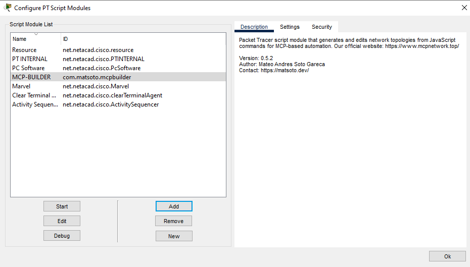

Selecciónalo de la lista y haz clic en el botón **Start** para ponerlo en marcha.

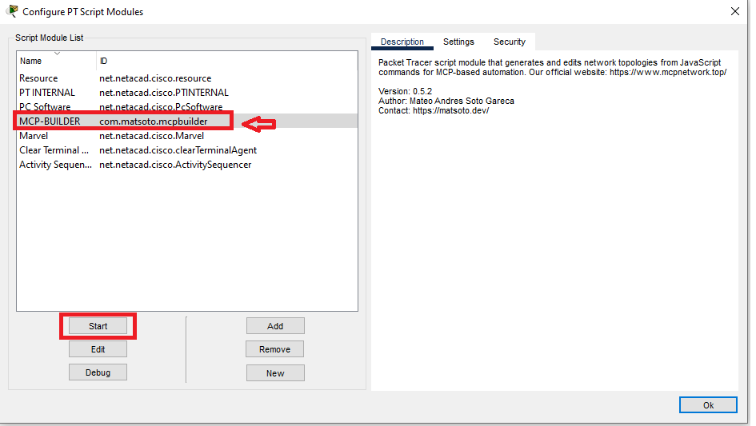

## Fase 3: Integración de MCP en Visual Studio Code

### 9. Exploración del Marketplace de Servidores MCP
Abre Visual Studio Code y dirígete al panel de extensiones para ubicar la sección de vista previa de los MCP Servers.

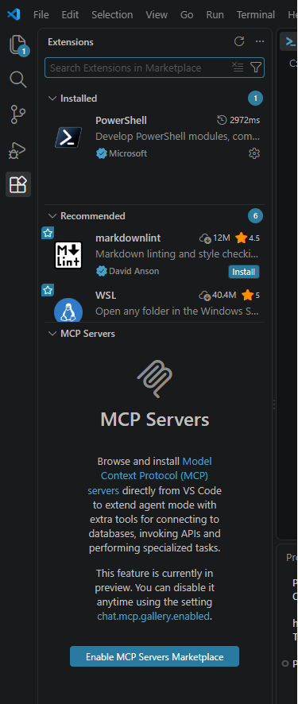

10. Acceso a las Preferencias de Usuario
Abre la paleta de comandos de VS Code presionando Ctrl + Shift + P, escribe preferences y selecciona la opción de gestión de preferencias o ajustes de usuario.

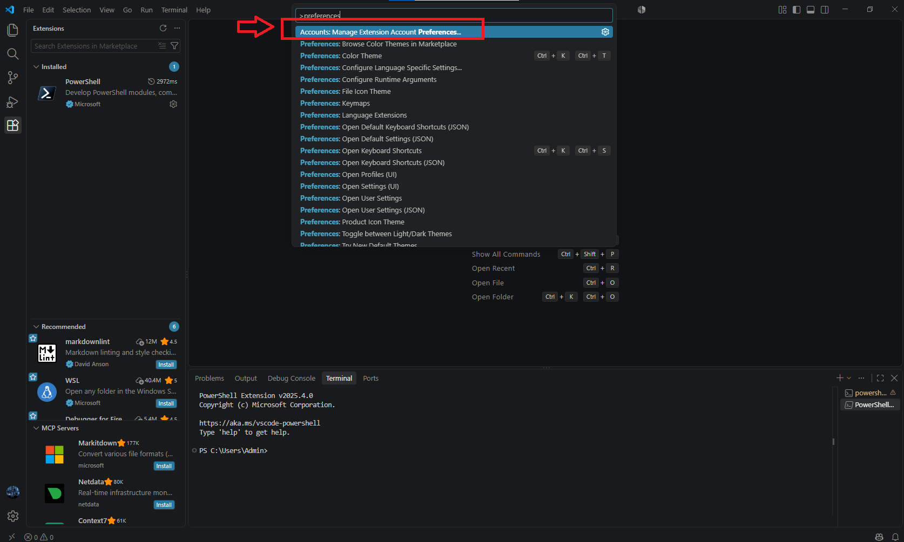

### 11. Activación de la Galería mediante Configuración JSON

Asegúrate de que tu archivo de configuración de usuario (`settings.json`) contenga la propiedad booleana que habilita el marketplace de chat para las extensiones MCP:


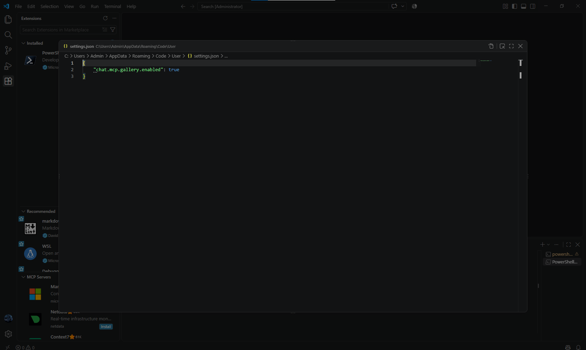

### 12. Conexion de Visual Studio Code con MCP Packet Tracert:

Paso 1: Ubicar la carpeta raíz de tu proyecto:

Abre tu proyecto en Visual Studio Code (en este caso, la carpeta donde tienes tu entorno o proyecto relacionado con la integración).

Asegúrate de estar en el directorio principal (la raíz).

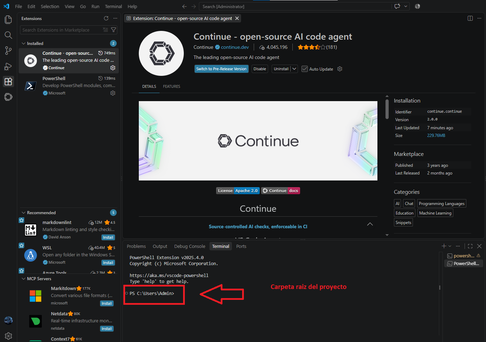

Paso 2: Crear la carpeta .vscode (si no existe):

En el explorador de archivos lateral de VS Code, verifica si ya existe una carpeta llamada .vscode.

Si no la ves, haz clic derecho en un espacio vacío de la raíz del proyecto, selecciona Nueva carpeta (New Folder) y nómbrala exactamente así:


```text
.vscode
```

Paso 2: Crear una carpeta llamada PacketTracerWorkspace dentro de C:\Users\Admin>:

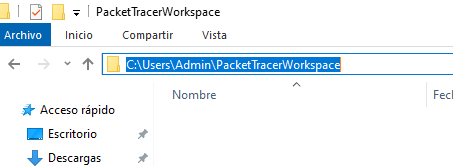

