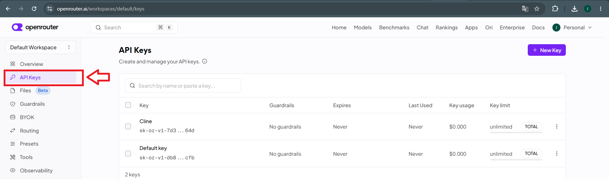
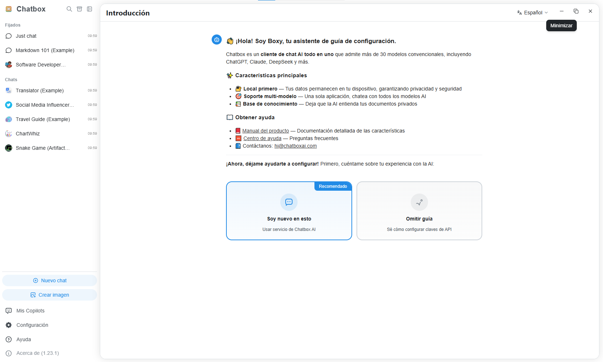

# TECHNICAL LOG & CHATBOX OPENROUTER MCP

## Traffic Manipulation via the Weight Attribute
**CCNP Miguelangel Luna**

---

## CONTENIDOS:

| Case | Title | Description |
| :--- | :--- | :--- |
| **01** | [Claude & n8n AI Agents](./case-01-Google-Auth/) | Agentes Claude . |
| **02** | [Packet Tracert & VS CODE](./case-02-PT-MCP-VS-Code/) | Conecta Packet Tracert con MCP |


## 1. Introduction and Theoretical Framework

El Model Context Protocol (MCP) utiliza una arquitectura cliente-servidor diseñada para estandarizar cómo los modelos de IA interactúan con entornos locales y remotos.

**Modelo fundacional (foundation model):** es un gran modelo de IA entrenado con una cantidad masiva de datosque sirve como una base sólida y general para múltiples aplicaciones. Se llaman "fundacionales" porque funcionan como los cimientos de un edificio: en lugar de crear una IA desde cero para cada tarea específica, los desarrolladores toman este modelo base y lo adaptan o especializan para miles de usos diferentes. Ejemplos de modelos fundacionales Claude (Anthropic),  Gemini (Google), GPT (OpenAI), Deepseek, Kimi AI.

Hay 2 tipos de modelos fundacionales:

1. **Modelos Propietarios (Cerrados / Comerciales):** Son desarrollados por grandes tecnológicas. Su código o pesos internos no se hacen públicos, pero se pueden usar mediante la web o sus API, ejemplos, Claude (Anthropic),  Gemini (Google), GPT (OpenAI).

2. **Modelos de Pesos Abiertos (Open Weights):** Son modelos cuyos archivos de entrenamiento se publican abiertamente para que la comunidad o las empresas puedan descargarlos, modificarlos y ejecutarlos por su cuenta. Ejemplos, Llama (Meta), Nemotron (NVIDIA), Mistral (Mistral AI).


**Cliente de Modelo Fundacional (Cliente LLM):** Aplicación (*frontend*)** instalada en PC que se comunica con el modelo fundacional, es decir, es la interfaz gráfica  instalada en la PC, Smartphone, etc. Como ejemplo el claude desktop se instala en tu PC y te permite comunicarte con el modelo de lenguaje de Anthropic (Claude) que corre en sus servidores **(*backend*)**.

Hay dos tipos de clientes Fundacionales LLM:

1) **Clientes oficiales de Grandes Modelos:**  Son aplicaciones creadas por las mismas empresas dueñas de la IA. Ejemplos, GitHub Copilot, Claude Desktop, ChatGPT Desktop App
   
2) **Clientes Universales / Agnósticos:**  Estos programas no tienen una IA propia. Son interfaces vacías que te permiten ingresar tus propias API Keys para conectarte al modelo que tú quieras, ejemplos (Claude, GPT, DeepSeek, Llama).

2.1) **Chatbox:** Uno de los clientes de escritorio más populares y limpios. Es multiplataforma (Windows, Mac, Linux, móviles) y te permite cambiar de proveedor de IA con un solo clic.
   
2.2) Cline en VS CODE.
   
2.3) Jan: Un cliente de escritorio excelente porque funciona de dos formas: puede conectarse a IA en la nube mediante API, o puede descargar modelos de código abierto para correr 100% en local en tu computadora (sin internet).

2.4) LibreChat: Un cliente web que clona exactamente la interfaz de ChatGPT, pero te permite conectar las API de Anthropic, OpenAI y otros proveedores en un solo lugar.

## 2. Implementacion de CHATBOX (Cliente Universal/Agnostico) en tu PC

Como requisito se debe tener una cuenta en OPENROUTER para generar las APIs:




1) Descargar Chatbox for windows

[Enlace de descarga](https://chatboxai.app/en/guide/getting-started/download)

2) Instalar



 3) Instalar

 3) 
## 3. BGP Configuration:

**Router A (RTA - AS 100):**

```text
! 
router bgp 100
!
```

### 4. BGP Configuration:
