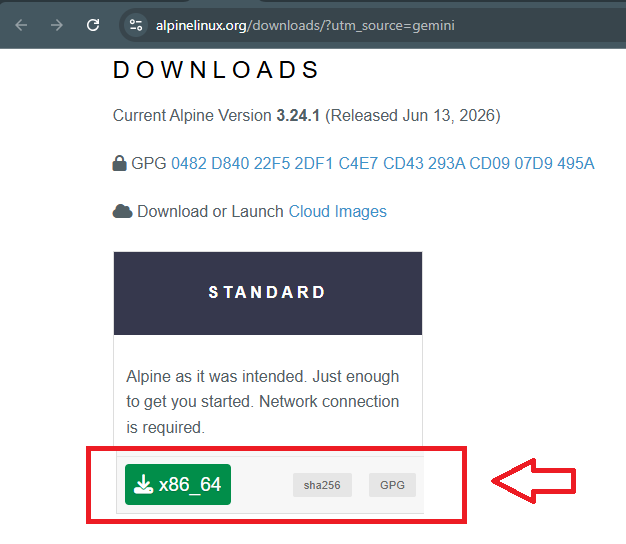
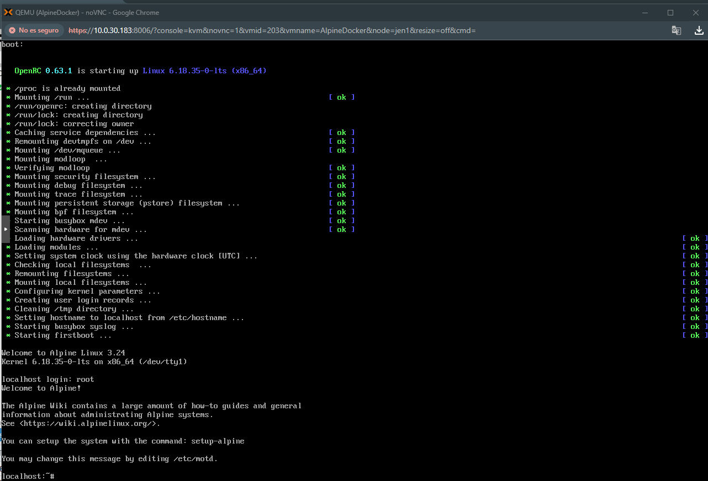

# TECHNICAL LOG & DOCKER FOUNDATIONS

## FUNDAMENTOS DE DOCKER LAB INSTALACION EN LINUX
**CCNP Miguelangel Luna**
---

## CONTENIDOS:

| Case | Title | Description |
| :--- | :--- | :--- |
| **01** | [Claude & n8n AI Agents](./case-01-Google-Auth/) | Agentes Claude . |
| **02** | [Packet Tracert & VS CODE](./case-02-PT-MCP-VS-Code/) | Conecta Packet Tracert con MCP |

## 1. Introduction and Theoretical Framework


## 2. Requisitos para instalacion en Linux:

2.1) Descargar una version lite de Linux, en este caso vamos a instalar [Alpine Linux X86_64](https://alpinelinux.org/downloads/?utm_source=gemini).



2.2) Instalar Alpine, practicamente se instala solo:



2.2) Ejecutar el siguiente comando,Se abrirá el asistente interactivo de configuración de Alpine para guiarte paso a paso con el teclado, la red, el disco y la contraseña. Escribe el siguiente comando y presiona Enter:

```text
setup-alpine
```

## 3. Instalacion de Docker:

3.1) Actualizar los repositorios e instalar el motor de Docker:

```text
apk update
apk add docker
```

3.2) Habilitar y arrancar el servicio de Docker

**Paso 2:** Una vez que termine, ejecuta los siguientes comandos para activar el servicio y dejarlo listo:

```text
rc-update add docker boot
service docker start
```

3.3) Verificacion que Docker esta instalado:

```text
docker run hello-world
```

## 3. Instalacion de Docker:


**Paso 2:** Ejecuta los siguientes comandos uno por uno para instalar el motor de contenedores:

## 3. BGP Configuration:

**Router A (RTA - AS 100):**

```text
! 
router bgp 100
!
```

