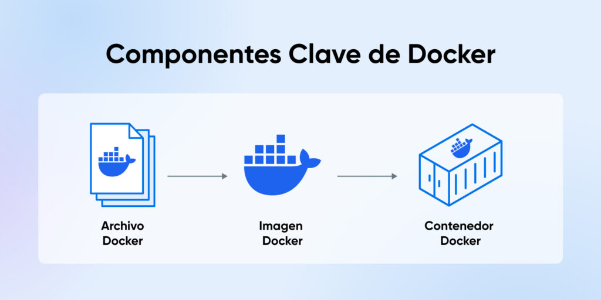
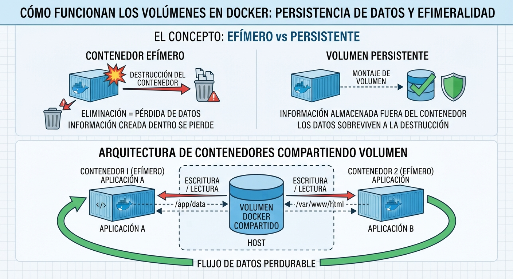
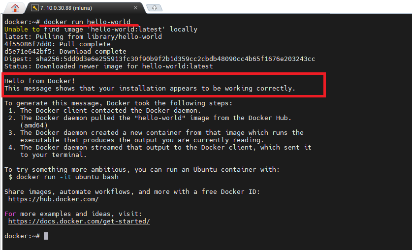
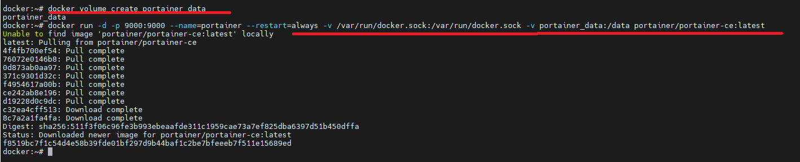
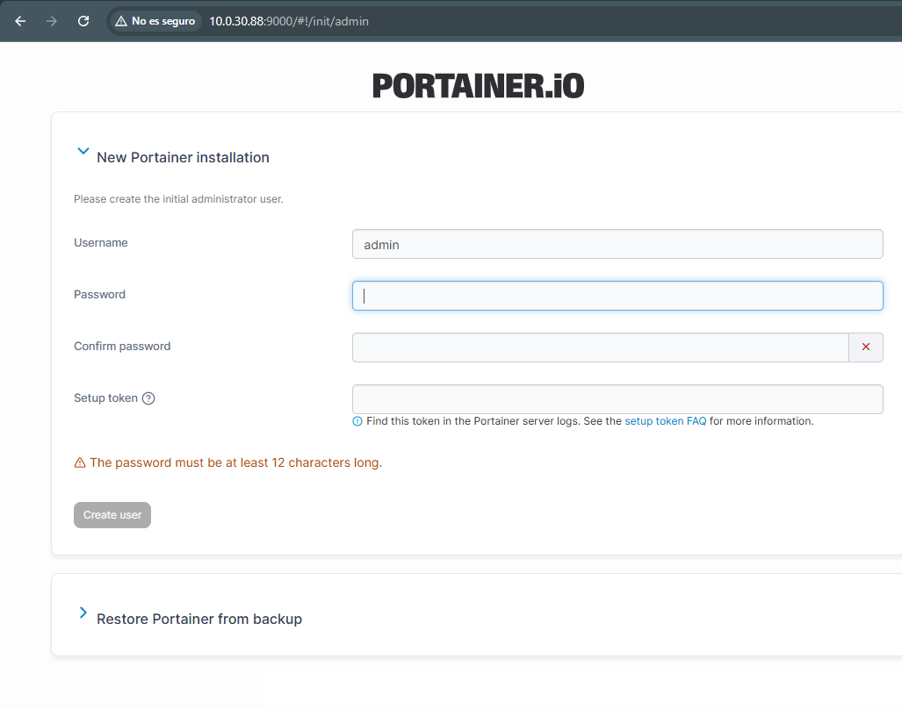
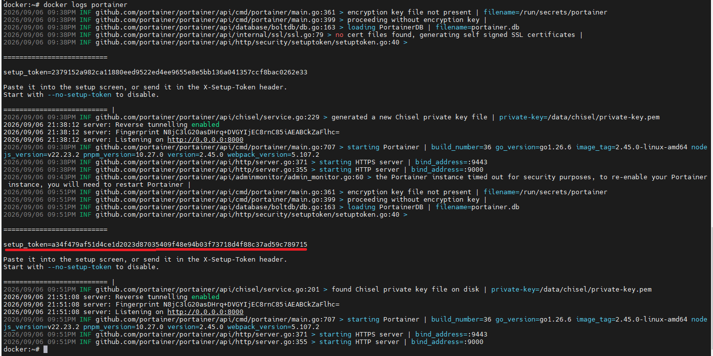

# TECHNICAL LOG & DOCKER FOUNDATIONS

## FUNDAMENTOS DE DOCKER LAB INSTALACION EN LINUX
**CCNP Miguelangel Luna**
---
Credenciales Portainer:
http://10.0.30.88:9000/#!/auth
Usuario:   admin
Password:  Samsung2026x

## CONTENIDOS:

| Case | Title | Description |
| :--- | :--- | :--- |
| **01** | [Claude & n8n AI Agents](./case-01-Google-Auth/) | Agentes Claude . |
| **02** | [Packet Tracert & VS CODE](./case-02-PT-MCP-VS-Code/) | Conecta Packet Tracert con MCP |

## 1. Introduction and Theoretical Framework



**Dockerfile**: El archivo docker es un documento de texto plano que contiene todas las instrucciones y comandos necesarios para ensamblar y construir una imagen de Docker de forma automática.

- **La imagen base:** El punto de partida (por ejemplo, usar un sistema operativo ligero como Alpine o instalar Python/Node.js).
- **Directorio de trabajo:** La carpeta interna donde se ubicará el proyecto dentro del contenedor.
- **Copia de archivos:** La orden para pasar tu código fuente desde tu computadora hacia el interior de la futura imagen.
- **Instalación de dependencias:** Los comandos para descargar librerías o herramientas necesarias.
- **Comando de inicio:** La instrucción final que le indica a Docker qué comando debe ejecutar cuando el contenedor cobre vida.

**Imagen en Docker:** Es una plantilla o un molde estático de solo lectura que contiene todo lo necesario para ejecutar una aplicación: el código fuente, las bibliotecas, las dependencias, las herramientas y las configuraciones.

Para entenderlo mejor con una analogía:

- **La imagen** es como el plano arquitectónico o la receta de un pastel (estática, no cambia y sirve como base).
- **El contenedor** es la casa ya construida o el pastel horneado en ese preciso momento (la instancia en ejecución que puedes usar, apagar o destruir).

**Contenedor:** Es un paquete de software ligero, autónomo y ejecutable que incluye todo lo necesario para que una aplicación funcione: código, tiempo de ejecución, herramientas del sistema, bibliotecas y configuraciones. Cada contenedor se aloja en su propia carpeta de forma indenpendiente. Un contenedor en Docker, importante, Los contenedores son entornos de ejecución en tiempo real y no carpetas estáticas.

- **Cada contenedor corre en su propia estructura:** A nivel interno, cada contenedor tiene su propio sistema de archivos aislado (su propia "carpeta" o entorno virtual donde opera su sistema operativo y su aplicación).
- **Efimeridad de un contenedor:** Toda la data o información que se genere durante su ciclo de vida se destruye una vez que el contenedor se apaga o termina su ciclo de vida.
- **Portabilidad:** Puede ejecutarse de manera idéntica en cualquier computadora, servidor o entorno en la nube que tenga Docker instalado.

**Volumen en Docker:** es el mecanismo gestionado íntegramente por Docker para almacenar y persistir datos fuera del sistema de archivos efímero de los contenedores. Se guarda en una zona dedicada del sistema anfitrión (*host*) y permite que la información sobreviva aunque el contenedor sea apagado, borrado o recreado, facilitando además que varios contenedores puedan compartir la misma información de forma segura y portable.




**Implementacion de Portabilidad:**

En el preciso momento en que ejecutas el comando de construcción (`docker build`), Docker lee el **`Dockerfile`** y descarga, compila y empaqueta todo lo necesario: la imagen base (con su sistema operativo ligero), las herramientas del sistema, las librerías o dependencias de tu aplicación, y tu propio código fuente.

Todo eso queda consolidado y congelado dentro de esa imagen resultante, lista para funcionar de manera idéntica en cualquier lugar donde la lleves.

### Cómo funciona en la práctica:

- **La Imagen (El molde):** La aplicación y sus dependencias se empaquetan en una imagen de Docker. Esa imagen la puedes subir a un repositorio (como Docker Hub) o guardarla en un archivo (`.tar`).
- **El traslado:** Te llevas esa imagen (o el archivo de texto `docker-compose.yml`) a otra PC con Windows y Docker Desktop.
- **La ejecución:** Al correr el comando de arranque, Docker en esa nueva PC reconstruye el contenedor usando esa misma imagen, garantizando que funcione exactamente igual que en la computadora original.

## 2. Requisitos para instalacion en Linux:

2.1) Descargar una version lite de Linux, en este caso vamos a instalar [Alpine Linux X86_64](https://alpinelinux.org/downloads/?utm_source=gemini).


2.2) Instalar Alpine, practicamente se instala solo:


2.2) Ejecutar el siguiente comando,Se abrirá el asistente interactivo de configuración de Alpine para guiarte paso a paso con el teclado, la red, el disco y la contraseña. Escribe el siguiente comando y presiona Enter:

```text
setup-alpine
```
## 3. Instalacion de Docker:

3.1) Actualizar los repositorios e instalar el motor de Docker con el comando **(apk add docker)** el cual es toda la infraesctrucuta Docker:

**Docker Engine:** Es la aplicación central de arquitectura cliente-servidor encargada de crear, empaquetar, distribuir y ejecutar contenedores de manera aislada y consistente en cualquier entorno, es decir, es ecosistema completo necesario para ejecutar la infraestructura de Docker en esa máquina.

### Componentes Principales
* **Daemon (`dockerd`):** El servicio en segundo plano que gestiona las imágenes, contenedores, redes y volúmenes.
* **API REST:** La interfaz que permite a las aplicaciones comunicarse con el Daemon.
* **Cliente (`docker`):** La interfaz de línea de comandos (CLI) que utilizas para enviar comandos al Daemon.

### Componentes Clave del Ecosistema
* **Docker Engine:** Motor central para construir y ejecutar contenedores.
* **Docker CLI:** Interfaz de línea de comandos.
* **Docker Compose:** Herramienta para definir y ejecutar aplicaciones Docker multi-contenedor.

```text
apk update
apk add docker
```

Con el comando **(apk add docker)** Has instalado el ecosismte completo de Docker Infraestructura.

> **Technical Note:** You have installed the complete ecosystem required to run the Docker infrastructure on that machine.

3.2) Habilitar y arrancar el servicio de Docker

**Paso 2:** EjecutaR los siguientes comandos para activar el servicio de Docker y dejarlo listo:

```text
rc-update add docker boot
service docker start
```

3.3) Verificacion que Docker esta instalado:

```text
docker run hello-world
```



## 4. Instalacion de Portainer para Gestionar el motor de Docker en Alpine:

**Portainer** es una interfaz gráfica de usuario (GUI) basada en web que permite administrar de forma sencilla entornos de **Docker** (contenedores, imágenes, volúmenes y redes) sin necesidad de usar la terminal o la línea de comandos. Funciones Principales de Portainer:

- **GUI de contenedores:** Inicia, detiene, reinicia, pausa y eliminar contenedores, además de inspeccionar sus registros (*logs*) en tiempo real.
- **Administración de recursos:** Facilita la creación y control de redes, volúmenes de almacenamiento e imágenes de Docker desde un solo panel.
- **Monitoreo del sistema:** Muestra métricas sobre el uso de CPU y memoria de los contenedores.
- **Consola integrada:** Permite abrir una terminal directamente desde el navegador web hacia el interior de cualquier contenedor.

Como Portainer se ejecuta a su vez dentro de un contenedor de Docker, el despliegue es sumamente rápido y limpio. El Portainer es el equivalente al Docker Desktop de Windows

 4.1) Ejecuta el siguiente comando para que Portainer guarde su configuración y datos de forma persistente:

```text
docker volume create portainer_data
```
 4.2) Ejecuta el siguiente comando para descargar y arrancar el servidor de Portainer conectándolo al socket de Docker de tu sistema:

```text
docker run -d -p 9000:9000 --name=portainer --restart=always -v /var/run/docker.sock:/var/run/docker.sock -v portainer_data:/data portainer/portainer-ce:latest
```



Una vez que ejecutes estos comandos, abre tu navegador web y entra a la siguiente dirección:

👉 `http://<IP-DE-TU-VM-ALFINE>:9000`



 4.3) Ejecuta el siguiente comando para reiniciar el portainer:
 
```text
docker restart portainer
```

 4.4) Obtencion del Token para poder loguearse a portainer:

```text
docker logs portainer
```


## 3. BGP Configuration:

**Router A (RTA - AS 100):**

```text
! 
router bgp 100
!
```

