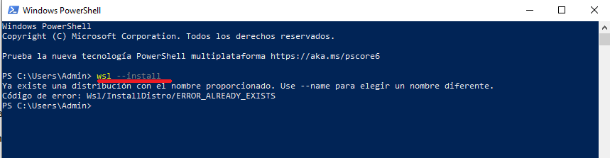

# TECHNICAL LOG & DOCKER FOUNDATIONS

## FUNDAMENTOS DE DOCKER LAB INSTALACION EN LINUX
**CCNP Miguelangel Luna**
---

## CONTENIDOS:

| Case | Title | Description |
| :--- | :--- | :--- |
| **01** | [Claude & n8n AI Agents](./case-01-Google-Auth/) | Agentes Claude . |
| **02** | [Packet Tracert & VS CODE](./case-02-PT-MCP-VS-Code/) | Conecta Packet Tracert con MCP |

## 1. Introduction and Theoretical Framework


## 2. Requisitos para instalacion en Linux:

2.1) Descargar una versio lite de Linux, en este caso vamos a instalar [Alpine Linux X86_64](https://alpinelinux.org/downloads/?utm_source=gemini).


2.1) Habilitar WSL2 en Windows 10, abre PowerShell como Administrador.
Ejecuta este comando y reinicia tu PC si te lo pide:

```text
wsl --install
```


2.2) Instalar Docker Engine dentro de WSL (Ubuntu):

Una vez dentro de tu terminal Linux (Ubuntu), ejecuta los siguientes comandos para instalar Docker de forma oficial:

Actualiza los repositorios:

```text
sudo apt update
```


## 3. Implementacion de LAB de Docker:


 four routers across different Autonomous Systems (AS 100, AS 200, AS 300, and AS 400). Before advertising prefixes, BGP neighbor adjacencies were established on each device.

## 3. BGP Configuration:

**Router A (RTA - AS 100):**

```text
! 
router bgp 100
!
```

