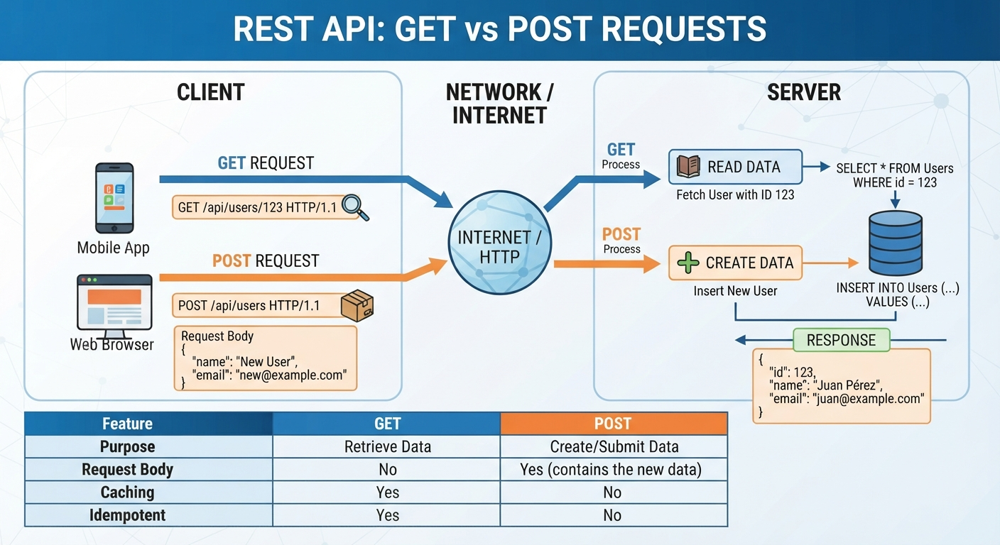
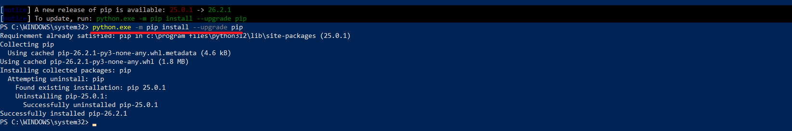

# GNS3 & MCP

## Conexion de GNS3 a traves de un API
**CCNP/CCAI Miguelangel Luna**

r
subrayado
---

## CONTENIDOS:

| Case | Title | Description |
| :--- | :--- | :--- |
| **01** | [Claude & n8n AI Agents](./case-01-Google-Auth/) | Agentes Claude . |
| **02** | [Packet Tracert & VS CODE](./case-02-PT-MCP-VS-Code/) | Conecta Packet Tracert con MCP |

[Google](https://www.google.com)

## 1. Introduction and Theoretical Framework

Para conectar GNS3 (versión 2.2.60) a un cliente o agente compatible con el protocolo MCP (Model Context Protocol) —en este caso utilizando Gemini AI (por ejemplo, a través de Gemini CLI, extensiones compatibles o entornos de desarrollo)—, la estrategia recomendada consiste en utilizar un servidor MCP especializado para GNS3 que actúe como puente (middleware). Existen servidores comunitarios diseñados específicamente para esto (como `gns3-mcp` o `gns3-mcp-server`) que exponen toda *la API REST de GNS3* y el control de consolas en formato de herramientas MCP.

 **¿Que es un JSON (JSON (JavaScript Object Notation)?**

Es el formato estándar que se utiliza para empaquetar y transportar los datos entre el cliente y el servidor.

 **¿Que es un API REST?**

 El API REST es el sistema completo (el conjunto de reglas y la interfaz) que permite la comunicación, es una arquitectura cliente-servidor basada en HTTP, donde una parte (el cliente) pide un recurso y la otra (el servidor) lo procesa y responde. El REST Es una forma de aplicar ese modelo cliente-servidor utilizando los protocolos que ya existen en la web (principalmente HTTP).

* El canal de transporte físico o la "autopista" por donde viaja todo es **HTTP** (con sus métodos como `GET` y `POST`).
* El idioma o formato en el que va empaquetada la información que viaja por ese canal es **JSON**.

Por lo tanto, el API REST utiliza el protocolo **HTTP** como canal de comunicacion, **JSON** como lenguaje/formato para conectar al cliente con el servidor y el metodo (también conocido como verbo HTTP) son las instrucciones y respuestas que se intercambian, es decir, un método  es la acción explícita que le indica al servidor qué es lo que el cliente quiere hacer con el recurso, por ejemplo: 

Imagina que el recurso es un archivo en una oficina:

* El método `GET` dice: "Quiero ver este archivo".
* El método `POST` dice: "Quiero crear un archivo nuevo".
* El método `PUT` dice: "Quiero reemplazar este archivo por completo".
* El método `DELETE` dice: "Quiero eliminar este archivo".


 


Esta imagen es un diagrama que ilustra el funcionamiento de una API REST.
Muestra el flujo completo:

* Un Cliente (como una app o navegador) realiza una Solicitud (Request) al Servidor a través de Internet usando métodos HTTP (`GET`, `POST`, etc.).
* El Servidor procesa la petición interactuando con su base de datos.
* El Servidor devuelve una Respuesta (Response) al Cliente, típicamente en formato JSON, confirmando el éxito (`200 OK`) con los datos solicitados.



## 2. Topologia e Infografia

The topology consists of four routers across different Autonomous Systems (AS 100, AS 200, AS 300, and AS 400). Before advertising prefixes, BGP neighbor adjacencies were established on each device.

## 3. Implementacion:

**POWERSHELL**

3.0) Script, el siguiente script se utiliza unicamente para obtener el path de donde esta instalado el Python y crearlo automaticamente esto se hace basicamente, para que desde cualquier lugar que estemos en el prompt de POWERSELL, pueda ser ejecutados los comandos de python.

```text
# 1. Obtener la ruta de los scripts de usuario desde Python y registrarla en el PATH de usuario
$PythonScriptsPath = [System.IO.Path]::Combine([Environment]::GetFolderPath('ApplicationData'), "Python", "Python312", "Scripts")

# Validar y agregar si no existe en el PATH actual del usuario
$UserPath = [Environment]::GetEnvironmentVariable("PATH", "User")
if ($UserPath -notlike "*$PythonScriptsPath*") {
    [Environment]::SetEnvironmentVariable("PATH", "$UserPath;$PythonScriptsPath", "User")
    Write-Host "¡Ruta agregada con éxito al PATH de usuario: $PythonScriptsPath" -ForegroundColor Green
} else {
    Write-Host "La ruta ya se encontraba registrada en el PATH." -ForegroundColor Yellow
}

# 2. Refrescar el PATH para la sesión actual de PowerShell
$env:PATH = [Environment]::GetEnvironmentVariable("PATH", "Machine") + ";" + [Environment]::GetEnvironmentVariable("PATH", "User")
```

3.1) Instalar el Servidor MCP de GNS3: mediante la instalacion del siguiente paquete

**POWERSHELL**

```text
pip install gns3-mcp
```


Opcional para actualizar el servidor MCP de GNS3 realizar lo siguiente:

**POWERSHELL**

```text
python.exe -m pip install --upgrade pip
```




3.2) Verificar la instalacion del Servidor MCP de GNS3.

**POWERSHELL**

```text
pip list | Select-String "gns3-mcp"
```


### Conexión del servidor MCP de GNS3 "gns3-mcp"  (instalado en el paso 3.1 a traves del comando pip install "gns3-mcp") con GNS3 VIRTUAL MACHINE SERVER

3.3)  Conectar el servidor MCP  de GNS3 "gns3-mcp" , para esto hay que tener los datos de conexion de la VM de GNS3, son los siguientes:

```text
IP SERVIDOR VM GNS3 = "10.0.30.50"
PUERTO SERVIDOR VM GNS3 = "80"
USUARIO SERVIDOR VM GNS3 = "gns3"
PASSWORD SERVIDOR VM GNS3 = "gns3"
```

Para que el servidor MCP pueda comunicarse con el GNS3 2.2.60 VIRTUAL MACHINE, necesitamos configurar las variables de entorno que el servidor requiere para la conexion a traves del siguiente script en POWERSHELL:

**POWERSHELL**

```text
# Limpiar variables
Remove-Item Env:\GNS3_* -ErrorAction SilentlyContinue

# Apuntar al puerto de API REST 3080 con la IP de la VM
$env:GNS3_HOST="10.0.30.50"
$env:GNS3_PORT="80"
$env:GNS3_USER="gns3"
$env:GNS3_PASSWORD="gns3"

# Ejecutar el servidor MCP
gns3-mcp
```

En la siguiente imagen podemos verificar que la conexion se realizo correctamente, sin embargo aparece el siguiente error:

En los logs se observa un nuevo error: **`HTTP 404 Not Found`** al intentar autenticarse en la ruta **`http://10.0.30.50/v3/access/users/authenticate`.**

*   **El motivo:** El error `404` significa que la ruta o endpoint de la API no existe en esa dirección. Esto suele ocurrir porque la versión de GNS3 que estás utilizando (la `2.2.60`) utiliza una estructura de rutas distinta em conclusion LA VERSION 2.2.60 DEL GNS3 USA AUTENTICACION v2 y el MCP server  ).
*   **La solución:** Asegúrate de especificar el puerto correcto de GNS3 en la variable de entorno `$env:GNS3_PORT`. 


Debes registrar el servidor MCP en el archivo de configuración de tu cliente compatible con Gemini (por ejemplo, en el archivo de ajustes del entorno o settings.json / mcp_config.json):  

```text
{
  "mcpServers": {
    "gns3": {
      "command": "gns3-mcp",
      "env": {
        "GNS3_BASE_URL": "http://10.0.30.50",
        "GNS3_USERNAME": "gns3",
        "GNS3_PASSWORD": "gns3"
      }
    }
  }
}
```

(Nota: Si usas una ruta absoluta o un entorno virtual, asegúrate de apuntar directamente al ejecutable del script o usar uvx gns3-mcp si prefieres gestión de paquetes moderna).

La configuracion del cliente GEMINI para probar la conexion:

### Configuración de Credenciales de GNS3


3.2) Probar la ejecución manual del servidor (Modo Stdio):

**POWERSHELL**

```text
gns3-mcp
```


Dado que el servidor se comunica típicamente por flujos estándar (`stdio`) con el cliente de IA, puedes invocarlo directamente en una terminal para ver si arranca sin arrojar errores de dependencias:

3.3). Validación de la Conexión

Una vez configurado e iniciado tu cliente de Gemini, puedes verificar que las herramientas de GNS3 estén disponibles ejecutando el comando de inspección en tu agente (por ejemplo, /mcp list o solicitándole directamente a Gemini):


### 4. BGP Configuration:
