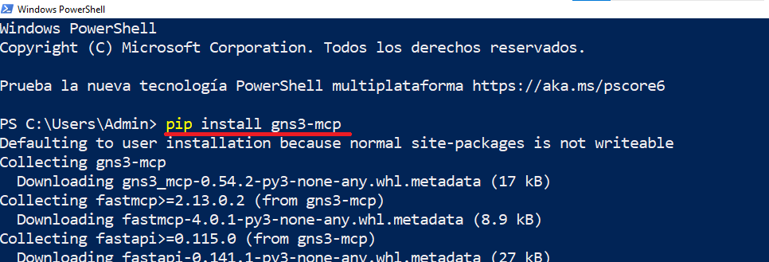

# GNS3 & MCP

## Conexion de GNS3 a traves de un API

## **CCNP/CCAI Miguelangel Luna**

Para conectar GNS3 (versión 2.2.60) a un cliente o agente compatible con el protocolo MCP (Model Context Protocol) —en este caso utilizando Gemini AI (por ejemplo, a través de Gemini CLI, extensiones compatibles o entornos de desarrollo)—, la estrategia recomendada consiste en utilizar un servidor MCP especializado para GNS3 que actúe como puente (middleware).

Existen servidores comunitarios diseñados específicamente para esto (como `gns3-mcp` o `gns3-mcp-server`) que exponen toda *la API REST de GNS3* y el control de consolas en formato de herramientas MCP.
---

## CONTENIDOS:

| Case | Title | Description |
| :--- | :--- | :--- |
| **01** | [Claude & n8n AI Agents](./case-01-Google-Auth/) | Agentes Claude . |
| **02** | [Packet Tracert & VS CODE](./case-02-PT-MCP-VS-Code/) | Conecta Packet Tracert con MCP |

[Google](https://www.google.com)

## 1. Introduction and Theoretical Framework

Para conectar GNS3 (versión 2.2.60) a un cliente o agente compatible con el protocolo MCP (Model Context Protocol) —en este caso utilizando Gemini AI (por ejemplo, a través de Gemini CLI, extensiones compatibles o entornos de desarrollo)—, la estrategia recomendada consiste en utilizar un servidor MCP especializado para GNS3 que actúe como puente (middleware).

## 2. Topologia e Infografia

The topology consists of four routers across different Autonomous Systems (AS 100, AS 200, AS 300, and AS 400). Before advertising prefixes, BGP neighbor adjacencies were established on each device.



 four routers across different Autonomous Systems (AS 100, AS 200, AS 300, and AS 400). Before advertising prefixes, BGP neighbor adjacencies were established on each device.

 Que es un API REST?


## 3. BGP Configuration:

**Router A (RTA - AS 100):**

```text
! 
router bgp 100
!
```

### 4. BGP Configuration:
