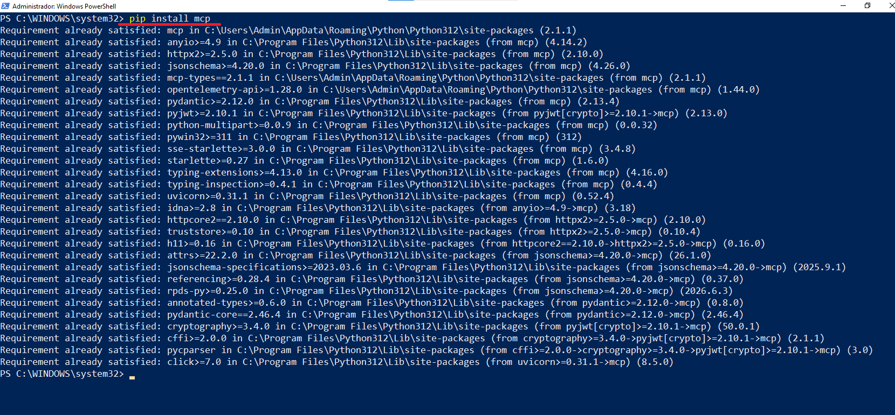
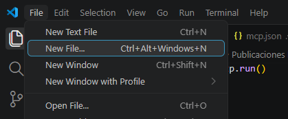
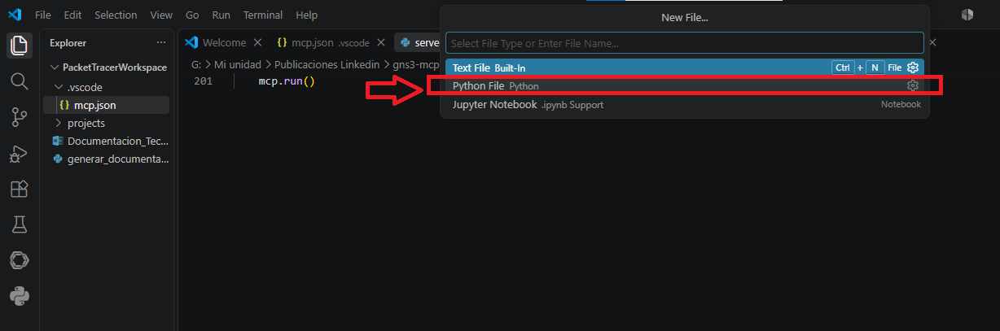
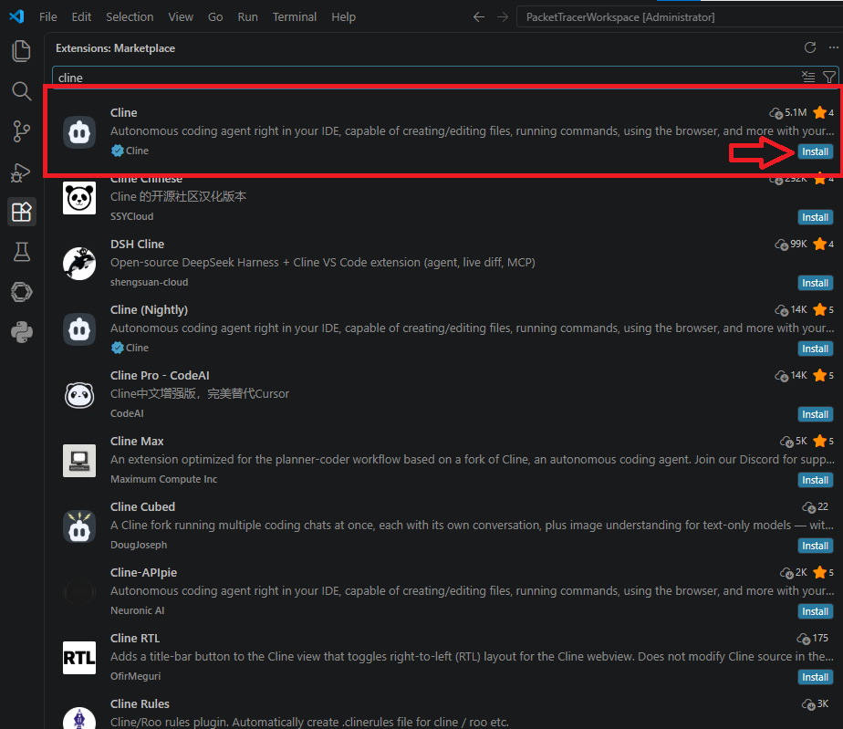
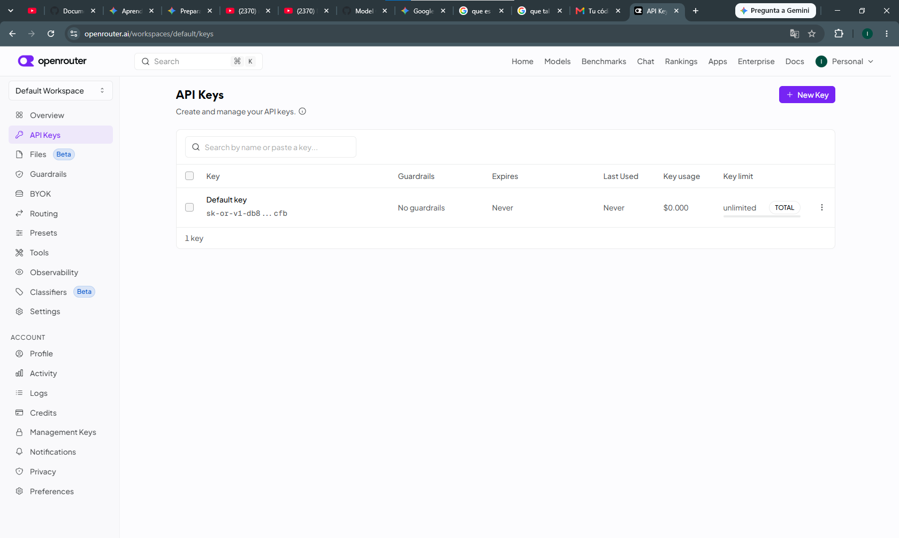
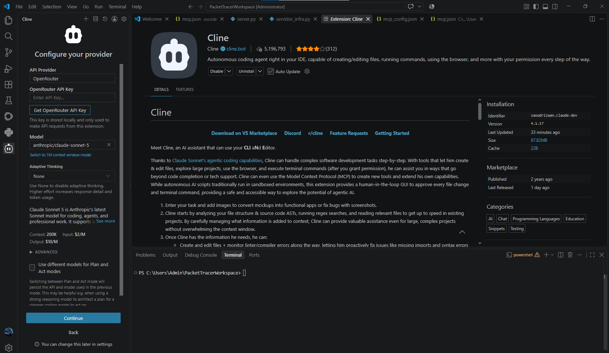

# TECHNICAL LOG & MCP ENGINEERING GUIDE

## MCP Server Foundations
**CCNP Miguelangel Luna**

---

## CONTENIDOS:

| Case | Title | Description |
| :--- | :--- | :--- |
| **01** | [Claude & n8n AI Agents](./case-01-Google-Auth/) | Agentes Claude . |
| **02** | [Packet Tracert & VS CODE](./case-02-PT-MCP-VS-Code/) | Conecta Packet Tracert con MCP |


[Google](https://www.google.com)

## 1. Introduction and Theoretical Framework (MODEL CONTEXT PROTOCOL)

El Model Context Protocol (MCP) utiliza una arquitectura cliente-servidor 🔌 diseñada para estandarizar cómo los modelos de IA interactúan con entornos locales y remotos.
Los tres componentes fundamentales son:

- **🤖 Cliente de IA:** La aplicación o interfaz que ejecuta el modelo y formula las peticiones.
- **⚙️ Servidor MCP:** Un programa intermediario y seguro que traduce las intenciones del modelo en acciones concretas sobre el sistema.
- **🗄️ Recursos del Sistema:** Las fuentes de datos, servidores, bases de datos o APIs de red que el agente necesita consultar o modificar.

Piensa en el servidor MCP como una interfaz adaptada específicamente para la IA: expone herramientas y recursos de forma estructurada para que el modelo no necesite conocer los detalles de bajo nivel de cada infraestructura.

Conceptos:

**Herramienta (Tool)**: Es una función estructurada que un servidor MCP expone para permitir que el modelo ejecute acciones en el mundo real o interactúe con sistemas externos. Ejemplo, analogia, La Herramienta (Tool): Es como un botón programado en la pared de una casa que dice claramente: “Encender luces del jardín (requiere: color y brillo)” o “Ajustar aire (requiere: grados)”, si el MCP solo tiene la herramienta ( “Encender luces del jardín”) solo podras hacer esa accion, si le pides al MCP otra accion como cerrar la llave de agua del jardin, NO LO PODRA hacer ya que no tienes ese boton (Herramienta) en el MCP.

En conclusion: "The AI model can only use the tools that are explicitly exposed by the MCP server." (El modelo de IA solo puede usar las herramientas o capacidades que están explícitamente expuestas por el servidor MCP).

¿Cómo se resuelve esto en la arquitectura real?
Tienes dos opciones principales para escalar las capacidades de tu agente:

1) **Ampliar el servidor actual (To expand):** Añadir una nueva función al código del mismo servidor MCP (por ejemplo, una herramienta llamada `control_water_valve`).
   
2) **Conectar múltiples servidores MCP (Multiplexing MCP servers):** Esta es la magia del protocolo. Un cliente de IA (como Claude Desktop) puede conectarse a varios servidores MCP al mismo tiempo.
  - Un servidor maneja las luces 💡.
  - Otro servidor maneja el sistema de riego 💧.

Cuando le pides algo al agente, este analiza las herramientas de todos los servidores conectados y elige la correcta de forma automática.

**Arquitectura basica:**

El Cliente de IA 🤖 envía una intención (ej: reiniciar base de datos).

El Servidor MCP ⚙️ recibe la petición, valida parámetros y ejecuta la acción real de forma segura.

El Servidor MCP ⚙️ devuelve una respuesta estructurada al Cliente (éxito/fallo y detalles).


## 2. Topology and Arquitectura:


## 3. Creacion de servidor BASICO de MCP:

Para que un Servidor MCP Básico en Python funcione correctamente, debe tener obligatoriamente estos 4 componentes clave:

- **🔌 Inicialización del Servidor (Server):**
  Se crea la instancia principal del servidor asignándole un nombre identificador (ej. `app = Server("infra-automation-server")`).
  
- **📋 Exposición de Herramientas (`@app.list_tools`):**
  Es el decorador y función donde el servidor le "anuncia" al cliente de IA qué herramientas tiene disponibles, incluyendo su nombre, descripción y el esquema de entrada (`inputSchema`) obligatorio en formato JSON.

El Proceso de Selección y Descubrimiento (list_tools) actúa como el Plano de Control.

- **⚙️ Lógica de Ejecución (`@app.call_tool`):**
  Es el receptor central. Aquí es donde el servidor toma los parámetros enviados por la IA, ejecuta la lógica real de infraestructura (redes, bases de datos, etc.) y procesa el resultado.

La Lógica de Ejecución (call_tool) es donde ocurre la acción real sobre la infraestructura.

- **🚀 Canal de Comunicación / Transporte (`stdio_server`):**
  Configura el mecanismo de transporte (generalmente la entrada/salida estándar `stdio`) para que el cliente de IA (como Claude Desktop) y el script de Python puedan conversar de forma local y segura.

El Canal de Transporte (stdio_server) es efectivamente el medio por donde fluyen los datos (Data Plane).

**El siguiente es un script de un servidor basico MCP**

IMPORTANTE el servidor de Python no cambia: el mismo archivo `servidor_infra.py` que diseñamos funcionará exactamente igual sin importar si se conectas a Claude Desktop, Cursor,  Cherry Studio, Visual Studio Code. Es decir el siguiente script funcionara para cualquier AI.

```text
from mcp.server import Server
import mcp.types as types
from mcp.server.stdio import stdio_server
import asyncio

# 1. Inicializamos el servidor MCP
app = Server("infra-automation-server")

# 2. Definimos una herramienta (Tool) para el agente
@app.list_tools()
async def handle_list_tools() -> list[types.Tool]:
    return [
        types.Tool(
            name="check_server_status",
            description="Verifica si un servidor o servicio de red está activo.",
            inputSchema={
                "type": "object",
                "properties": {
                    "server_ip": {
                        "type": "string",
                        "description": "La dirección IP o nombre del servidor a verificar."
                    }
                },
                "required": ["server_ip"]
            }
        )
    ]

# 3. Lógica que se ejecuta cuando la IA usa la herramienta
@app.call_tool()
async def handle_call_tool(name: str, arguments: dict) -> list[types.TextContent]:
    if name == "check_server_status":
        ip = arguments.get("server_ip")
        
        # Simulación de verificación de infraestructura
        # (Aquí iría la lógica real de red o ping)
        estado_exitoso = True 
        
        if estado_exitoso:
            return [types.TextContent(type="text", text=f"Servidor {ip} responde correctamente. Código: 1 (Éxito)")]
        else:
            return [types.TextContent(type="text", text=f"Error al conectar con {ip}. Código: 0 (Fallo)")]
            
    raise ValueError(f"Herramienta desconocida: {name}")

# 4. Ejecución del servidor usando transporte estándar (stdio)
async def main():
    async with stdio_server() as (read_stream, write_stream):
        await app.run(
            read_stream,
            write_stream,
            app.create_initialization_options()
        )

if __name__ == "__main__":
    asyncio.run(main())
```

### 4. IMPLEMENTACION DE MCP EN VISUAL STUDIO CODE:

Paso 1: Instalar las dependencias necesarias

Abre tu terminal (en VS Code o en tu sistema operativo) y asegúrate de tener Python instalado. Luego, instala el SDK oficial de MCP ejecutando:

```text
pip install mcp
```



Paso 2: Crear el archivo del servidor de Python

2.1) Abre Visual Studio Code New File.



2.2) Escoge archivo Pyhton:



2.3) Copia el siguiente codigo y guarda el archivo como **servidor_infra.py.**

```text
from mcp.server import Server
import mcp.types as types
from mcp.server.stdio import stdio_server
import asyncio

# 1. Inicializamos el servidor MCP
app = Server("infra-automation-server")

# 2. Definimos la herramienta para la IA
@app.list_tools()
async def handle_list_tools() -> list[types.Tool]:
    return [
        types.Tool(
            name="check_server_status",
            description="Verifica si un servidor o servicio de red está activo.",
            inputSchema={
                "type": "object",
                "properties": {
                    "server_ip": {
                        "type": "string",
                        "description": "La dirección IP o nombre del servidor a verificar."
                    }
                },
                "required": ["server_ip"]
            }
        )
    ]

# 3. Lógica de ejecución cuando la IA invoca la herramienta
@app.call_tool()
async def handle_call_tool(name: str, arguments: dict) -> list[types.TextContent]:
    if name == "check_server_status":
        ip = arguments.get("server_ip")
        
        # Simulación de verificación de infraestructura
        estado_exitoso = True 
        
        if estado_exitoso:
            return [types.TextContent(type="text", text=f"Servidor {ip} responde correctamente. Código: 1 (Éxito)")]
        else:
            return [types.TextContent(type="text", text=f"Error al conectar con {ip}. Código: 0 (Fallo)")]
            
    raise ValueError(f"Herramienta desconocida: {name}")

# 4. Ejecución del servidor usando transporte estándar (stdio)
async def main():
    async with stdio_server() as (read_stream, write_stream):
        await app.run(
            read_stream,
            write_stream,
            app.create_initialization_options()
        )

if __name__ == "__main__":
    asyncio.run(main())
```

Paso 3: Instalar la extensión Cline en VS Code

- Abre Visual Studio Code.
- Ve al panel de extensiones (`Ctrl + Shift + X`).
- Busca e instala la extensión Cline.




Paso 4: Configurar IA Gratuita en la Nube (Sin costo y sin correr nada local)
Para que Cline funcione gratis usando la nube:

- Entra a OpenRouter.ai y crea una cuenta gratuita (puedes registrarte con Google o GitHub).
- Ve a la sección de API Keys y genera una clave nueva.



- Abre el panel de Cline en la barra lateral de VS Code y ve a sus Settings (Configuración).
- Configura los datos del proveedor:
  - **API Provider:** Selecciona OpenRouter.
  - **API Key:** Pega la clave que generaste.
  - **Model:** Elige alguno de los modelos potentes marcados como gratuitos (por ejemplo, busca los que terminan en `:free` como `deepseek/deepseek-chat` o equivalentes disponibles en su catálogo).



Paso 5: Registrar tu Servidor MCP en Cline.

Dentro de la misma interfaz de configuración de Cline, busca la sección de MCP Servers y añade la configuración apuntando a tu script de Python:

Importante en el siguiente script debes colocar la ruta completa a donde esta el archivo (servidor_infra.py):

**G:\\Mi unidad\\Publicaciones Linkedin\\MCP Servers\\MCPserverscript\\servidor_infra.py**

```text
{
  "mcpServers": {
    "infra-automation": {
      "command": "python",
      "args": [
        "G:\\Mi unidad\\Publicaciones Linkedin\\MCP Servers\\MCPserverscript\\servidor_infra.py"
      ]
    }
  }
}
```
