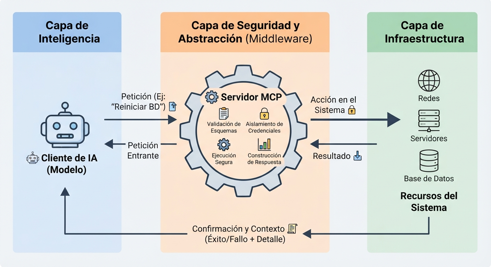

# TECHNICAL LOG & MCP ENGINEERING GUIDE

## MCP Server Foundations
**CCNP Miguelangel Luna**

---

## CONTENIDOS:

| Case | Title | Description |
| :--- | :--- | :--- |
| **01** | [Claude & n8n AI Agents](./case-01-Google-Auth/) | Agentes Claude . |
| **02** | [Packet Tracert & VS CODE](./case-02-PT-MCP-VS-Code/) | Conecta Packet Tracert con MCP |
| **03** | [Generar un Archivo Word desde Markdown usando Phyton](./case-03-Markdown-Word-Using-Phyton/) | Convierte un MD a Word usando Phyton |
| **04** | [GNS3 AI](./case04-GNS3-AI/) | Conexion GNS3 MCP. |

[Google](https://www.google.com)

## 1. Introduction and Theoretical Framework (MODEL CONTEXT PROTOCOL)

El Model Context Protocol (MCP) utiliza una arquitectura cliente-servidor 🔌 diseñada para estandarizar cómo los modelos de IA interactúan con entornos locales y remotos.
Los tres componentes fundamentales son:

- **🤖 Cliente de IA:** La aplicación o interfaz que ejecuta el modelo y formula las peticiones.
- **⚙️ Servidor MCP:** Un programa intermediario y seguro que traduce las intenciones del modelo en acciones concretas sobre el sistema.
- **🗄️ Recursos del Sistema:** Las fuentes de datos, servidores, bases de datos o APIs de red que el agente necesita consultar o modificar.

Piensa en el servidor MCP como una interfaz adaptada específicamente para la IA: expone herramientas y recursos de forma estructurada para que el modelo no necesite conocer los detalles de bajo nivel de cada infraestructura.

Arquitectura basica:

El Cliente de IA 🤖 envía una intención (ej: reiniciar base de datos).

El Servidor MCP ⚙️ recibe la petición, valida parámetros y ejecuta la acción real de forma segura.

El Servidor MCP ⚙️ devuelve una respuesta estructurada al Cliente (éxito/fallo y detalles).

## 2. Topology and Arquitectura:



## 3. Creacion de servidor BASICO de MCP:

**Router A (RTA - AS 100):**

```text
! 
router bgp 100
!
```

### 4. BGP Configuration:

