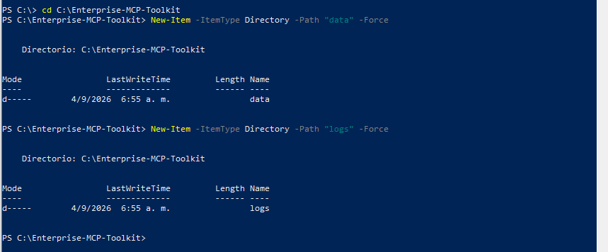
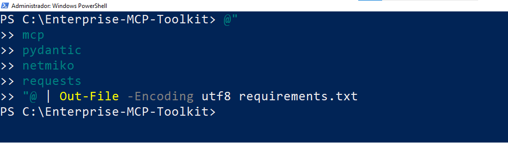
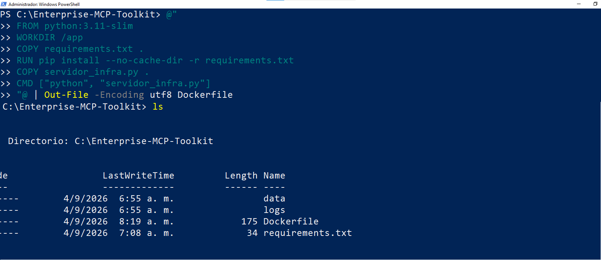
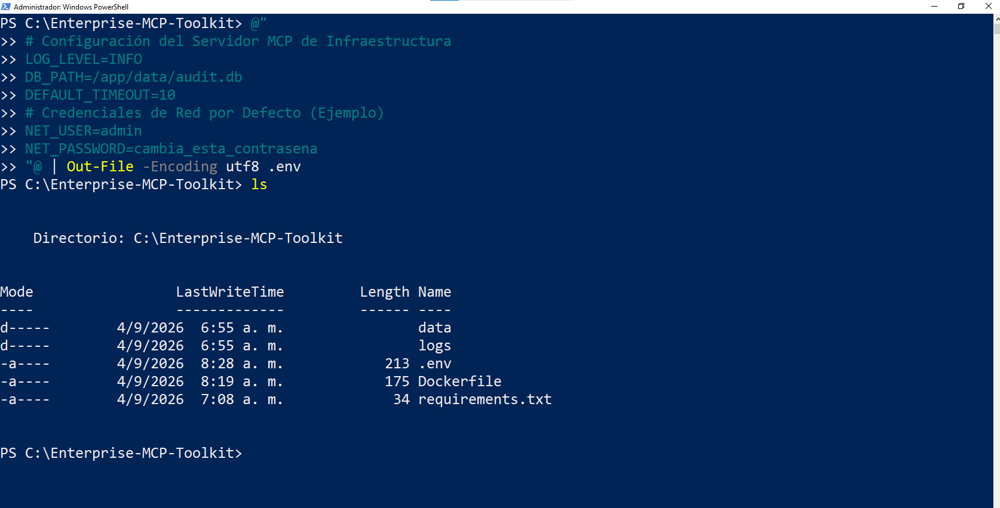
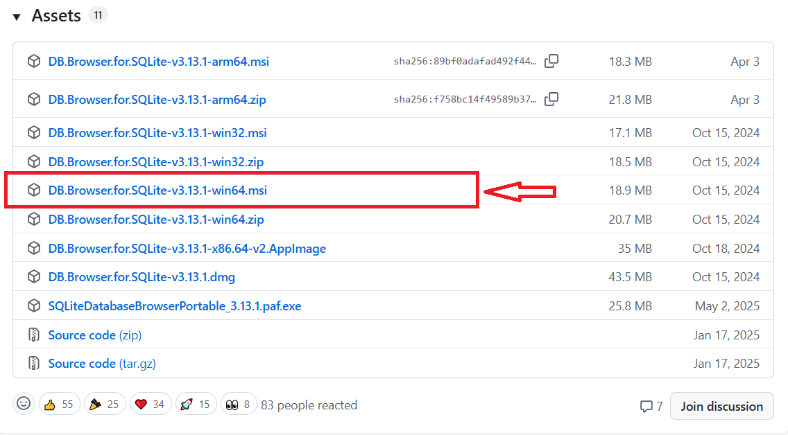
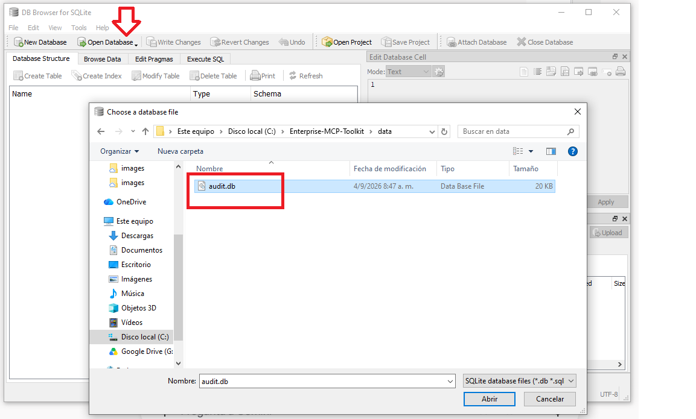
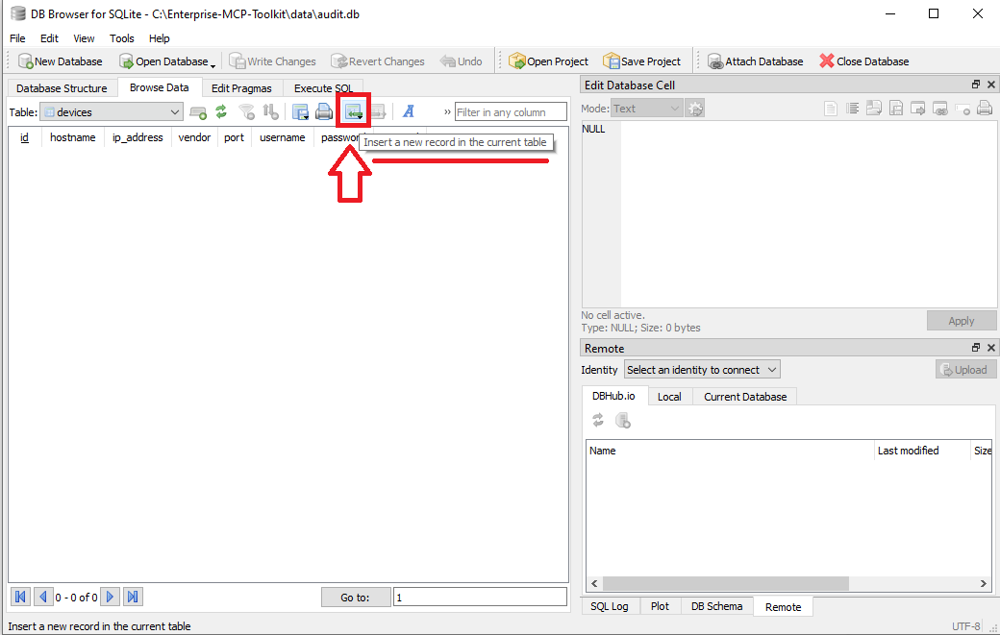

# TECHNICAL LOG & DOCKER FOUNDATIONS

## Traffic Manipulation via the Weight Attribute
**CCNP Miguelangel Luna**

---

## CONTENIDOS:

| Case | Title | Description |
| :--- | :--- | :--- |
| **01** | [Claude & n8n AI Agents](./case-01-Google-Auth/) | Agentes Claude . |
| **02** | [Packet Tracert & VS CODE](./case-02-PT-MCP-VS-Code/) | Conecta Packet Tracert con MCP |
| **03** | [Generar un Archivo Word desde Markdown usando Phyton](./case-03-Markdown-Word-Using-Phyton/) | Convierte un MD a Word usando Phyton |
| **04** | [GNS3 AI](./case04-GNS3-AI/) | Conexion GNS3 MCP. |

[Google](https://www.google.com)

## 1. Introduction and Theoretical Framework

jajaja


## 2. Implementation

### Paso 1: Creación de la Estructura Base de Directorios

Para mantener un orden de nivel empresarial, lo primero que haremos es crear la carpeta principal del proyecto y sus subdirectorios para persistencia (como SQLite y logs) directamente desde tu terminal de PowerShell o comandos en Windows 10.

**Instrucciones para ti:**
* Abre tu terminal de PowerShell en Windows 10.
* Ejecuta los siguientes comandos uno por uno para crear la estructura limpia del proyecto:

**POWERSHELL**
```text
cd C:\
New-Item -ItemType Directory -Path "C:\Enterprise-MCP-Toolkit" -Force
```


**POWERSHELL**
```text
cd C:\Enterprise-MCP-Toolkit
New-Item -ItemType Directory -Path "data" -Force
New-Item -ItemType Directory -Path "logs" -Force
```
 


### Paso 2: Creación del archivo de dependencias (requirements.txt) este archivo es tambien llamado (MANIFIESTO de dependencias):

### 2.1 Crear el archivo `requirements.txt`: Gestión de Dependencias

Como necesitamos que nuestro servidor MCP maneje protocolos de red y la estructura del protocolo MCP en Python, vamos a declarar las dependencias técnicas de forma limpia. El archivo **requirements.txt** es la lista de ingredientes (las librerías de Python) a este archivo se le llama **manifiesto**, y el Dockerfile que haremos a continuación será la receta de cocina completa que le dice a Docker cómo juntar esos ingredientes, el sistema operativo base y tu código para hornear el contenedor final.

**Manifiesto de dependencias:** En el ecosistema de Docker y desarrollo moderno, un "manifiesto" es cualquier archivo de configuración declarativo que describe de forma estática lo que un sistema o contenedor necesita para existir y funcionar (como el `requirements.txt` para Python, el `package.json` en Node.js, o el propio `Dockerfile`). Es la "declaración de intenciones" de la aplicación.

* **¿Para qué sirve?:** Sirve como un manifiesto o lista de compras para Docker y Python. En lugar de instalar las herramientas una por una de forma manual, Docker lee este archivo durante la construcción del contenedor **(`docker build`)** y descarga automáticamente todas las librerías necesarias de golpe. **Esto garantiza que tu kit sea portátil y funcione exactamente igual en cualquier computadora donde lo despliegues.**

###**¿Qué pasa si una dependencia ya no existe o cambia de versión?: Gestión de Riesgos y Dependencias**

* **¿Qué analizamos?:** El riesgo de obsolescencia de paquetes o cambios drásticos en los repositorios públicos (como PyPI).
* **¿Qué sucede técnicamente?:** Si una versión exacta declarada desaparece o el repositorio oficial la elimina, el comando de instalación (`pip install`) dentro de Docker fallará al momento de construir la imagen, deteniendo el proceso de despliegue.
* **¿Cómo lo mitigamos a nivel empresarial?:**
  * **Uso de versiones fijas (Pinning):** En entornos de producción críticos, en lugar de poner solo `netmiko`, se especifican versiones exactas (ej. `netmiko==4.3.0`) para garantizar consistencia.
  * **Caché local o espejos privados:** Al empaquetar todo dentro de Docker y mantenerlo en tu kit portátil, una vez que la imagen se construye exitosamente por primera vez, **la imagen compilada ya lleva las librerías dentro. No necesita volver a descargarlas de internet cada vez que la ejecutes, lo que te independiza de futuras caídas de internet o cambios en la web.**

Instrucciones para ti:
Asegúrate de seguir ubicado en la ruta del proyecto en tu PowerShell **(C:\Enterprise-MCP-Toolkit)** .

Ejecuta el siguiente comando para crear y poblar el archivo **requirements.txt**  con las librerías necesarias:

**POWERSHELL**
```text
@"
mcp
pydantic
netmiko
requests
"@ | Out-File -Encoding utf8 requirements.txt
```




### Paso 3: Creación del Dockerfile: Construcción de la Receta Docker

* **¿Qué hacemos?:** Crearemos el archivo **`Dockerfile` (sin extensión)** en la carpeta raíz `C:\Enterprise-MCP-Toolkit`.
* **¿Para qué sirve?:** Es el plano maestro que Docker leerá para ensamblar nuestra imagen. Le indica que utilizaremos una versión ligera de Python 3.11, copiará nuestro manifiesto **(`requirements.txt`)**, instalará las librerías necesarias de forma limpia y dejará preparado el script de nuestro servidor MCP para ejecutarse automáticamente.

### 3.1 Crear el archivo `requirements.txt`: Gestión de Dependencias

**Instrucciones para ti:**
* Asegúrate de estar ubicado en la ruta del proyecto en tu PowerShell:

**POWERSHELL**
```text
cd C:\Enterprise-MCP-Toolkit
```
Creacion del Dockerfile:

**POWERSHELL**
```text
@"
FROM python:3.11-slim
WORKDIR /app
COPY requirements.txt .
RUN pip install --no-cache-dir -r requirements.txt
COPY servidor_infra.py .
CMD ["python", "servidor_infra.py"]
"@ | Out-File -Encoding utf8 Dockerfile
```

Verifica en tu explorador de archivos o mediante un `dir` en PowerShell que el archivo **`Dockerfile` (exactamente así, sin extensión `.txt`) aparezca junto al `requirements.txt`.**




### Paso 4: Crear el archivo de variables de entorno (`.env`): Configuración y Persistencia

* **¿Qué hacemos?:** Crearemos un archivo llamado `.env` en la raíz del proyecto para almacenar de forma segura las credenciales de red y parámetros de configuración.
  
* **¿Para qué sirve?:** Sirve para aplicar la mejor práctica de **Gestión Segura de Credenciales.** Evita que las contraseñas de tus routers, switches o servidores queden "quemadas" o expuestas dentro del código fuente de Python o el `Dockerfile`, permitiendo que el contenedor las lea de forma aislada e inyectada.

Importante en este archivo vamos a gestionar las credenciales:

### Credenciales de Red por Defecto (Ejemplo)

* **`NET_USER=admin`**
* **`NET_PASSWORD=cambia_esta_contrasena`**

### 1. ¿A qué pertenecen `NET_USER` y `NET_PASSWORD`?: Análisis de Seguridad

* **¿Qué son?:** Son variables de entorno genéricas configuradas como plantilla o credenciales por defecto (*fallback*) dentro del kit.
* **¿A qué acceso pertenecen?:** Pertenecen al acceso de administración por red (SSH / Telnet / API) hacia los dispositivos de infraestructura de red que tu kit va a administrar y auditar (es decir, los routers, switches y firewalls de marcas como Cisco, Huawei, Aruba o Fortinet que tu script consultará mediante librerías como `netmiko`).
* **¿Cómo se usan en el entorno empresarial?:** Sirven para que el servidor MCP tenga un usuario y contraseña base al intentar conectarse a los equipos de red en caso de que no se le especifique una credencial individual por dispositivo. Al estar en el archivo `.env`, puedes cambiarlas fácilmente por las credenciales reales de tu entorno de producción sin tocar ni modificar el código de la aplicación.

**Instrucciones para ti:**
* Asegúrate de estar posicionado en **`C:\Enterprise-MCP-Toolkit`.**
* Ejecuta el siguiente comando en tu PowerShell para crear la plantilla inicial del archivo `.env`:

**POWERSHELL**
```text
@"
# Configuración del Servidor MCP de Infraestructura
LOG_LEVEL=INFO
DB_PATH=/app/data/audit.db
DEFAULT_TIMEOUT=10
# Credenciales de Red por Defecto (Ejemplo)
NET_USER=admin
NET_PASSWORD=cambia_esta_contrasena
"@ | Out-File -Encoding utf8 .env
```



### Paso 5: Inicialización del motor SQLite para Inventario y Auditoría Multivendor: Arquitectura de Base de Datos

* **¿Qué hacemos?:** Crearemos el script o módulo de inicialización de la base de datos (**`init_db.py`** o integrado en nuestro servidor) que establecerá la estructura relacional para almacenar tanto el inventario de dispositivos multivendor (Cisco, Huawei, Fortinet, etc.) con sus respectivas credenciales, como el registro histórico de auditorías.
 
* **¿Para qué sirve?:** Sirve para dotar al kit de una "memoria estructurada". En lugar de depender de credenciales estáticas globales, cada dispositivo de red tendrá su propia entrada segura con su IP, marca, protocolo y credenciales dedicadas, cumpliendo con los estándares de robustez de nivel empresarial.

#### Instrucciones para el Paso 5:
* Para mantener nuestro entorno limpio y modular, crearemos un script auxiliar llamado **`init_db.py`** que se encargará de levantar las tablas relacionales (`devices` y `audit_logs`) dentro de nuestra carpeta `data/audit.db`.
  
* 5.1) Asegúrate de estar posicionado en la ruta de tu proyecto en PowerShell:

**POWERSHELL**
```text
cd C:\Enterprise-MCP-Toolkit
```

* 5.2) Ejecuta el siguiente bloque de comandos para crear el archivo **`init_db.py`** :

**POWERSHELL**
```text
@"
import sqlite3
import os

DB_PATH = "data/audit.db"

def init_database():
    os.makedirs(os.path.dirname(DB_PATH), exist_ok=True)
    conn = sqlite3.connect(DB_PATH)
    cursor = conn.cursor()

    # Tabla de Inventario y Credenciales Multivendor
    cursor.execute('''
        CREATE TABLE IF NOT EXISTS devices (
            id INTEGER PRIMARY KEY AUTOINCREMENT,
            hostname TEXT UNIQUE NOT NULL,
            ip_address TEXT NOT NULL,
            vendor TEXT NOT NULL,          -- cisco, huawei, fortinet, aruba, etc.
            port INTEGER DEFAULT 22,
            username TEXT NOT NULL,
            password TEXT NOT NULL,
            protocol TEXT DEFAULT 'ssh'
        )
    ''')

    # Tabla de Historial de Auditoría y Cambios
    cursor.execute('''
        CREATE TABLE IF NOT EXISTS audit_logs (
            id INTEGER PRIMARY KEY AUTOINCREMENT,
            timestamp DATETIME DEFAULT CURRENT_TIMESTAMP,
            hostname TEXT NOT NULL,
            action TEXT NOT NULL,
            status TEXT NOT NULL,
            details TEXT
        )
    ''')

    conn.commit()
    conn.close()
    print("[INFO] Base de datos SQLite inicializada correctamente en:", DB_PATH)

if __name__ == "__main__":
    init_database()
"@ | Out-File -Encoding utf8 init_db.py
```

5.3) Ejecuta el script para probar la creación de la base de datos localmente:

**POWERSHELL**
```text
python init_db.py
```

### Paso 5.4: Aprovisionamiento de Credenciales en la Base de Datos (Pre-Despliegue)

* **¿Cuándo se ejecuta?:** Estrictamente después de haber inicializado la base de datos (Paso 5) y antes de desplegar el contenedor o conectar n8n.
* **¿Por qué es necesario?:** Es el puente donde el conocimiento humano (tus contraseñas y accesos reales) se registra de forma segura en el archivo físico local para que la aplicación no intente operar a ciegas.

#### Guía Paso a Paso para el Aprovisionamiento Visual:

Debes tener instalado previamente la aplicaion **DB Browser for SQLite Instalador**:

Link de descarga:

[**DB Browser for SQLite Instalador**](https://github.com/sqlitebrowser/sqlitebrowser/releases)

Escoge el siguiente instalador (Instalador de DB Browser for Windows):



1. **Localiza el archivo de base de datos: (audit.db)**

   Dirígete en tu explorador de archivos de Windows a la ruta: **`C:\Enterprise-MCP-Toolkit\data\audit.db`**

3. **Abre la herramienta gráfica:**
   Inicia **DB Browser for SQLite** (o cualquier cliente SQLite de tu preferencia). Arrastra o abre el archivo `audit.db` dentro de la aplicación.
   


4. **Inserta los dispositivos de red:**
   * Ve a la pestaña **Browse Data** (Explorar datos).
   * Selecciona la tabla `devices` en el menú desplegable.
   * Haz clic en el botón de **New Record** (Nueva fila) e ingresa los datos reales de tus equipos de infraestructura:
     * `hostname`: Identificador único del equipo (ej. `core-sw-01`, `edge-router-02`).
     * `ip_address`: Dirección IP de gestión (ej. `192.168.10.2`).
     * `vendor`: Marca del equipo en minúsculas (`cisco`, `huawei`, `fortinet`, `aruba`).
     * `port`: Puerto de acceso SSH (por defecto `22`).
     * `username`: Tu usuario administrador de red.
     * `password`: Tu contraseña real de acceso.
     * `protocol`: Protocolo de comunicación (`ssh`).


       

5. **Guarda los cambios:**
   Haz clic en el botón **Write Changes** (Guardar cambios / Disquete) en la barra superior de la herramienta para que los datos queden grabados permanentemente en el archivo SQLite.
