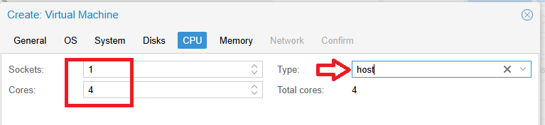
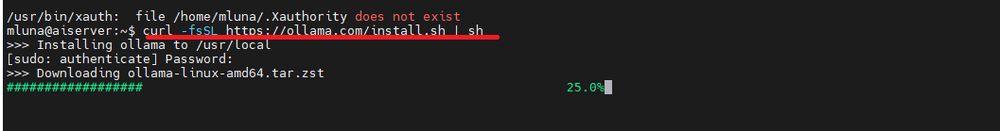
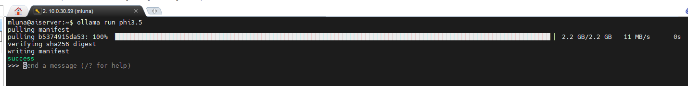

# TECHNICAL LOG & IMPLEMENTACION IA LOCAL

## Implementacion de Modelo Fundacional de forma local
**CCNP Miguelangel Luna** P.ssw.rd2018

---

## CONTENIDOS:

| Case | Title | Description |
| :--- | :--- | :--- |
| **01** | [Claude & n8n AI Agents](./case-01-Google-Auth/) | Agentes Claude . |
| **02** | [Packet Tracert & VS CODE](./case-02-PT-MCP-VS-Code/) | Conecta Packet Tracert con MCP |

[Google](https://www.google.com)

## 1. Introduction and Theoretical Framework

**Inferencia:** Se refiere al momento en que el modelo procesa una pregunta (prompt) y genera una respuesta.

**Motor de inferencia (inference engine):**  Software encargado de cargar un modelo de IA en la (RAM o VRAM) y ejecutar los cálculos matemáticos necesarios para procesar un texto de entrada (*prompt*) y generar una respuesta (inferencia). En este proyecto vamos a usar **OLLAMA**. **Ollama** es el reproductor de video y los modelos fundacionales **(Phi-3.5 o Qwen 2.5)** son las películas.

**Modelo Fundacional:** Es una IA a gran escala entrenada con volúmenes masivos de datos. Sirve como una base flexible y multipropósito que se puede adaptar fácilmente mediante instrucciones o ajustes para realizar miles de tareas diferentes (como escribir, programar o analizar datos), en lugar de estar limitada a una sola función específica.  En este proyecto vamos a usar los modelos fundacionales **(Phi-3.5 o Qwen 2.5)**.

**Modelo Fundacional Pequeño (*Small Language Model*):** es un modelo de IA entrenado a gran escala —igual que los modelos gigantes—, pero diseñado con una cantidad reducida de parámetros (por lo general, menos de 10 mil millones). Ejemplos de SML:

* **Phi-3.5 Mini (3.8B):** Excelente velocidad y bajo consumo de RAM.
* **Qwen 2.5 (7B):** Muy superior en tareas de análisis sintáctico de código.

**Nota:** **Los modelos SML como Phi-3.5 Mini o Qwen 2.5 son los cerebros (los archivos de pesos neuronales que Ollama ejecuta)**. Son los archivos pesados (de varios gigabytes) que ya vienen entrenados con millones de datos y que contienen todo el conocimiento para redactar, programar o analizar código.

**El Backend (El motor y el cerebro):** El Backend de esta arquitectura esta conformada por **Ollama (motor/reproductor)**  y el FM (Conocimiento) **(Phi-3.5 o Qwen 2.5)**  Ambos viven y solo pueden operar juntos (son dependientes) en tu VM de Ubuntu Server.

* **Ollama:** Funciona como el servidor de aplicaciones y motor de ejecución o reproduccion del FM.
* **El modelo fundacional (ej. Phi-3.5 o Qwen 2.5):** Es el conjunto de datos y pesos neuronales que procesa la información (conocimiento).
* 
**RAG (*Retrieval-Augmented Generation*):** Técnica utilizada en IA para mejorar la precisión y confiabilidad los *LLM* (GPT, Gemini, etc.).

****


## 2. Infografia.


### 1. Requisitos de Hardware Optimizados

Para mantener la eficiencia sin comprometer los recursos generales del servidor Proxmox:

* **CPU:** Mínimo **4 vCPUs** con soporte para instrucciones AVX2 (Intel Core de 8ª gen en adelante o AMD Ryzen/EPYC).  
* **Memoria RAM:** **12 GB a 16 GB** dedicados al FM (permite manejar con soltura el modelo de 3.8B/7B y ventanas de contexto grandes para logs de Rsyslog).  
* **Almacenamiento:** **60 GB en SSD/NVMe** (usando Thin Provisioning en Proxmox) para alojar el OS, los pesos de los SLMs y la persistencia de datos analizados.
* **Aceleración (Opcional):** GPU compatible (ej. NVIDIA con **6+ GB de VRAM**) mediante PCIe Passthrough si requieres alta velocidad en tiempo real.

---

### 2. Arquitectura Recomendada en Proxmox (VM vs LXC)

* **Elección Segura:** Se recomienda utilizar una **Máquina Virtual (VM)** con Ubuntu Server 24.04 LTS en lugar de un contenedor LXC.  
* **Justificación de Seguridad:** Las VMs ofrecen un aislamiento completo del kernel (*sandbox*), evitan vulnerabilidades de elevación de privilegios hacia el host Proxmox y simplifican la gestión de controladores y respaldos (*snapshots* nativos).

---

### 4. IMPLEMENTACION IA LOCAL Instalacion de OS (Ubuntu Server):

4.1) [Descargar Ubuntu Server 24.04 LTS](https://ubuntu.com/download/server?utm_source=gemini)

4.2) Crear la Máquina Virtual en Proxmox, con los siguientes parámetros: 

  * **Systema (Proxmox):**
Marca la casilla Qemu Agent:** Habilítala, para que Proxmox se comunique con la VM, permita apagarla/reiniciarla desde el panel, monitorear RAM y disco.


   * **Disco:** 60 GB (SCSI/NVMe).
     
Ideal SSDs/NVMe y habilitar **Discard** (habilita TRIM/UNMAP), sin embargo, no la habilitamos por ser un disco mecanico.


   * **Cores:** 4 vCPUs (con tipo de CPU `host`).
 
 Implementacion minima CPU: La opción `host` le permite a la VM "heredar"  las instrucciones avanzadas del CPU físico (como AVX2 o instrucciones vectoriales).



   * **Memoria:** 12288 MB (12 GB), le coloque 16 RAM
   * 

 
   * **Red:** VirtIO (paravirtualizado).


     

**Nota:** Una vez instalada la VM de Ubuntu debe tener acceso por SSH.
     
4.3) Instalación oficial y limpia de Ollama:

Ollama es el motor de inferencia local.

### 5. Instalacion de Motor de Inferencia lOCAL OLLAMA:

5.1)**Instalacion de OLLAMA:** Es la herramienta de software que  permitira correr el FM **(Phi-3.5 y/o Qwen 2.5)** en tu servidor VM UBUNTU.

```text
curl -fsSL https://ollama.com/install.sh | sh
```

Ollama es el motor de inferencia local (ejecuta los FM en la VM). Este comando cumple funciones críticas:

* **Automatiza la detección de hardware:** Analiza si la VM tiene CPU compatible o una tarjeta gráfica (GPU NVIDIA).
* **Descarga el binario oficial seguro:**  Descarga Ollama la versión binaria compilada.
* **Configura el servicio del sistema (Systemd):** Instala Ollama como un servicio (`systemctl`). Esto garantiza que si vm se reinicia, el motor de IA arrancará automáticamente y quedará escuchando en el puerto local (`11434`), listo para recibir las peticiones de tus scripts de Python.



¡Instalación completada con éxito! El script finalizó correctamente y ya tienes Ollama operando como servicio de fondo en tu máquina virtual.

Puntos clave del resultado de la instalación:

* **Servicio activo:** Ollama ya está corriendo  en `127.0.0.1:11434`, listo para recibir peticiones locales.
* **Modo CPU:** `WARNING: No NVIDIA/AMD GPU detected. Ollama will run in CPU-only mode.`, es normal ya usaremos CPU la memoria RAM del host (sin tarjeta gráfica dedicada).

5.2)Descarga de los Modelos Optimizados para correr local:

Descargar el primer modelo de lenguaje **(Phi-3.5)**, ejecuta el siguiente comando en tu terminal:

```bash
ollama run phi3.5
```
* **Phi-3.5 Mini (3.8B):** Excelente velocidad y bajo consumo de RAM.
* **Qwen 2.5 (7B):** Muy superior en tareas de análisis sintáctico de código.



Ejecuta el siguiente comando en la terminal de tu VM para descargar el modelo de forma segura:

```text
ollama run qwen2.5:7b
```

