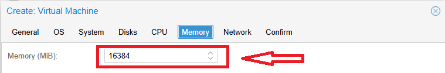
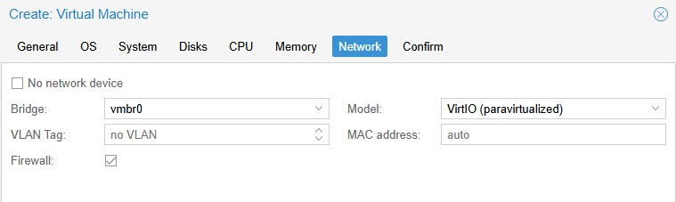
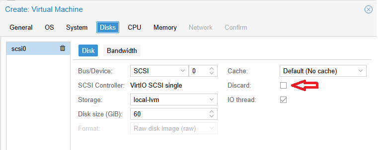
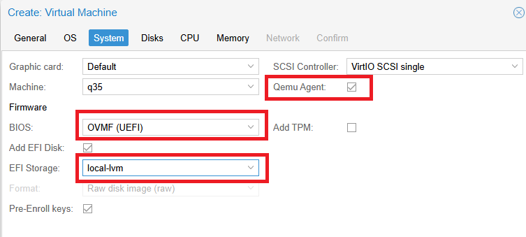

# TECHNICAL LOG & IMPLEMENTACION IA LOCAL

## Traffic Manipulation via the Weight Attribute
**CCNP Miguelangel Luna**

---

## CONTENIDOS:

| Case | Title | Description |
| :--- | :--- | :--- |
| **01** | [Claude & n8n AI Agents](./case-01-Google-Auth/) | Agentes Claude . |
| **02** | [Packet Tracert & VS CODE](./case-02-PT-MCP-VS-Code/) | Conecta Packet Tracert con MCP |

[Google](https://www.google.com)

## 1. Introduction and Theoretical Framework

**Inferencia:** Se refiere al momento en que el modelo procesa una pregunta (prompt) y genera una respuesta.


## 2. Topology and BGP Neighbor Establishment

The topology consists of four routers across different Autonomous Systems (AS 100, AS 200, AS 300, and AS 400). Before advertising prefixes, BGP neighbor adjacencies were established on each device.


 four routers across different Autonomous Systems (AS 100, AS 200, AS 300, and AS 400). Before advertising prefixes, BGP neighbor adjacencies were established on each device.

### 1. Requisitos de Hardware Optimizados

Para mantener la eficiencia sin comprometer los recursos generales del servidor Proxmox:

* **CPU:** Mínimo **4 vCPUs** con soporte para instrucciones AVX2 (procesadores Intel Core de 8ª gen en adelante o AMD Ryzen/EPYC).  
* **Memoria RAM:** **12 GB a 16 GB** dedicados exclusivamente al entorno del modelo (permite manejar con soltura el modelo de 3.8B/7B y ventanas de contexto grandes para logs de Rsyslog).  
* **Almacenamiento:** **60 GB en SSD/NVMe** (usando Thin Provisioning en Proxmox) para alojar el sistema operativo, los pesos de los SLMs y la persistencia de datos analizados.
* **Aceleración (Opcional):** Una GPU compatible (ej. NVIDIA con **6+ GB de VRAM**) mediante PCIe Passthrough si requieres alta velocidad en tiempo real.

---

### 2. Arquitectura Recomendada en Proxmox (VM vs LXC)

* **Elección Segura:** Se recomienda utilizar una **Máquina Virtual (VM)** con Ubuntu Server 24.04 LTS en lugar de un contenedor LXC.  
* **Justificación de Seguridad:** Las VMs ofrecen un aislamiento completo del kernel (*sandbox*), evitan vulnerabilidades de elevación de privilegios hacia el host Proxmox y simplifican la gestión de controladores y respaldos (*snapshots* nativos).


**Router A (RTA - AS 100):**

```text
! 
router bgp 100
!
```

### 4. IMPLEMENTACION IA LOCAL:

4.1) [Descargar Ubuntu Server 24.04 LTS](https://ubuntu.com/download/server?utm_source=gemini)

4.2) Crear la Máquina Virtual en Proxmox, con los siguientes parámetros:  

   * **Cores:** 4 vCPUs (con tipo de CPU `host`).
 Implementacion minima CPU: La opción `host` le permite a la VM "heredar"  las instrucciones avanzadas del CPU físico (como AVX2 o instrucciones vectoriales).


   * **Memoria:** 12288 MB (12 GB).
   * 

 
   * **Red:** VirtIO (paravirtualizado).


     
   * **Disco:** 60 GB (SCSI/NVMe).
     
Ideal SSDs/NVMe y habilitar **Discard** (habilita TRIM/UNMAP), sin embargo, no la habilitamos por ser un disco mecanico.




  * **Systema (Proxmox):**
Marca la casilla Qemu Agent:** Habilítala, para que Proxmox se comunique con la VM, permita apagarla/reiniciarla desde el panel, monitorear RAM y disco.



Nota: Una vez instalada la VM de Ubuntu debe tener acceso por SSH.
     
4.3) Instalación oficial y limpia de Ollama:

Ollama es como el motor de inferencia local.

**Instalacion de OLLAMA:**

```text
curl -fsSL https://ollama.com/install.sh | sh
```

Ollama es como el motor de inferencia local (el "cerebro" que ejecuta los modelos de lenguaje sin salir de tu red). Este comando cumple funciones críticas:

* **Automatiza la detección de hardware:** El script analiza automáticamente si tu máquina virtual cuenta con CPU compatible o si detecta una tarjeta gráfica (como una GPU NVIDIA mediante *passthrough*) para configurar los controladores necesarios (CUDA, ROCm, etc.).
* **Descarga el binario oficial seguro:** Se conecta directamente a los servidores oficiales de Ollama para descargar la versión binaria compilada y lista para ejecutarse en tu arquitectura de procesador.
* **Configura el servicio del sistema (Systemd):** Instala Ollama como un servicio de fondo del sistema operativo (`systemctl`). Esto garantiza que si la máquina virtual se reinicia, el motor de IA arrancará automáticamente y quedará escuchando en el puerto local (`11434`), listo para recibir las peticiones de tus scripts de Python que analizan los logs de Rsyslog o las configuraciones de Fortinet.


4.4)Descarga de los Modelos Optimizados para correr local:

* **Phi-3.5 Mini (3.8B):** Excelente velocidad y bajo consumo de RAM.
* **Qwen 2.5 (7B):** Muy superior en tareas de análisis sintáctico de código, configuraciones de redes y scripts de auditoría.

Ejecuta el siguiente comando en la terminal de tu VM para descargar el modelo de forma segura:

```text
ollama run qwen2.5:7b
```

