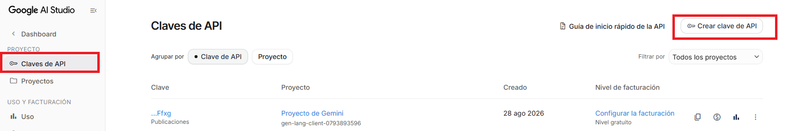
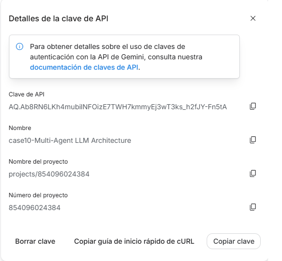
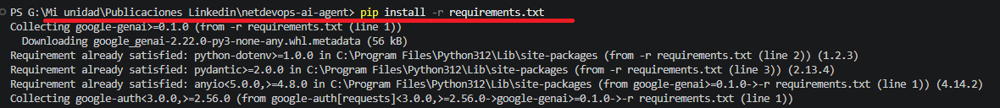

# TECHNICAL LOG & MULTI AGENT LLM ARCHITECTURE

## **CCNP Miguelangel Luna**
---

## INFOGRAFIA:

Pasos de implementacion **ARQUITECTURA MULTIAGENTE:**

1) Estructura de directorios: 
2) Obtener la API key Gratuita (Google AI studio).
3) Instalar dependencias python **(requirements.txt)**.
4) Instalar librerias **(pip install -r requirements.txt)**.
5) Configurar credenciales **(.env)**.
6) Crear agentes especializados:
   
   6.1) **Agente de Routing (`agents/routing_agent.py`)**: Especialista en protocolos de enrutamiento dinámico (BGP, OSPF) y diseño de red.
   6.2) **Agente de Seguridad (`agents/security_agent.py`)**: Especialista en firewalls de nueva generación (Palo Alto, Fortinet) y control de acceso (Cisco ISE).
   
8) Crear el Supervisor / Plano de Control **(`supervisor.py`)**.
9) Crear el archivo principal **(`main.py`)** y ejecutar el sistema multi-agente.


## **Google AI Studio (API KEY):** 

```text
AQ.Ab8RN6LKh4mubilNFOizE7TWH7kmmyEj3wT3ks_h2fJY-Fn5tA
```
**Google AI Studio (API KEY) Nombre y numero de Proyecto:** 
```text
projects/854096024384
```

## CONTENIDOS:

| Case | Title | Description |
| :--- | :--- | :--- |
| **01** | [Claude & n8n AI Agents](./case-01-Google-Auth/) | Agentes Claude . |
| **02** | [Packet Tracert & VS CODE](./case-02-PT-MCP-VS-Code/) | Conecta Packet Tracert con MCP |
| **03** | [Generar un Archivo Word desde Markdown usando Phyton](./case-03-Markdown-Word-Using-Phyton/) | Convierte un MD a Word usando Phyton |
| **04** | [GNS3 AI](./case04-GNS3-AI/) | Conexion GNS3 MCP. |

[Google](https://www.google.com)

## 1. Arquitectura de LLM Multi-Agente (Arquitectura de LLMs Multi-Agente):


**(Arquitectura de LLMs Multi-Agente):** Sistemas donde múltiples agentes de IA especializados colaboran para resolver tareas complejas que un solo prompt o modelo monolítico no podría manejar eficientemente.

**Orquestación Jerárquica o Supervisor-Trabajador:** Es el patrón de diseño exacto de control. Tienes un agente central (el FM o "Router") como arquitecto jefe o director de orquesta, el cual analiza la tarea y delega subtareas a los agentes especializados en los bordes.

**Enrutamiento Dinámico de Tareas (Dynamic Task Routing) y Role Prompting:**

> **Definición:** Los pasos 1 y 4 combinan la técnica de asignación de roles estrictos (*Role Prompting*) con la capacidad del sistema de rutear inteligentemente la petición del usuario hacia el dominio técnico correcto.

> **Nota técnica:** Las arquitecturas de LLM multi-agente descomponen tareas monolíticas complejas en roles de agentes especializados y cooperativos (por ejemplo, orquestadores, desarrolladores, revisores) para mejorar la precisión, la profundidad de razonamiento y la modularidad.
---

### Componentes Clave de los Sistemas Multi-Agente

* **Orquestador / Enrutador:** Coordina el flujo de trabajo, gestiona la distribución de tareas y determina qué agente especializado debe encargarse de una subtarea determinada.
* **Agentes Especializados:** Instancias de LLM configuradas con mensajes, herramientas y restricciones distintivas adaptadas a dominios específicos (por ejemplo, generación de código, auditoría de seguridad, documentación).
* **Contexto / Estado Compartido:** Una memoria centralizada o bus de comunicación (como un patrón de pizarra o un intermediario de mensajes) que permite a los agentes compartir resultados intermedios y mantener la conciencia situacional.

## 2. Capas de funcionamiento:

**2.1) Primera capa (System Prompt):** 

* **El Prompt (System Prompt):** Aquí configuras la "personalidad", las restricciones y el contexto técnico del agente. **¿Dónde se hace?** en la configuración del agente dentro de tu framework de IA (como LangChain, CrewAI, AutoGen o Cursor).

### Ejemplo de Prompt instrucción:

> "Eres un Ingeniero de Seguridad de Redes senior, experto en firewalls Palo Alto (PAN-OS), Fortinet (FortiOS) y Cisco ISE. Tu único objetivo es diseñar, validar y auditar políticas de seguridad, NAT y control de acceso. No respondas sobre routing dinámico BGP a menos que afecte directamente al filtrado de tráfico."

**2.2) Segunda capa (RAG / Contexto Estático):** 

* **Definición:** Un LLM general sabe un poco de todo, pero para que sea experto en una tecnología de nicho, debes alimentarlo con la documentación oficial exacta.**¿Dónde se hace?**
creando un repositorio de documentos (PDFs de manuales oficiales, guías de comandos CLI, APIs de PAN-OS o FortiOS) indexados en una base de datos vectorial (como Chroma, Pinecone o Qdrant) a la que solo ese agente tenga acceso. Si buscas algo 100% gratuito para correr en tu máquina sin depender de servicios en la nube externos, tanto Chroma (ideal para prototipos rápidos en Python) como Qdrant (excelente para producción y alto rendimiento) son las mejores opciones.

**2.3) Herramientas y Servidores MCP Exclusivos (Tools & Capabilities):** 

**(Tools & Capabilities):** Aquí es donde el agente deja de ser solo un "conversador" y pasa a tener superpoderes técnicos específicos. **¿Dónde se hace?** Al configurar los servidores del *Model Context Protocol* (MCP). **¿Cómo funciona?** Al Agente de Seguridad no le das herramientas para configurar BGP en un router Cisco, sino que **le conectas un servidor MCP especializado en la API REST de Palo Alto o Fortinet**, permitiéndole leer y validar objetos, reglas de seguridad y perfiles de amenaza directamente contra un firewall de pruebas o la API del fabricante.

**2.4) El Enrutador o Orquestador (The Router / Master Agent) PLANO DE CONTROL:** 

**The Router / Master Agent:** Es el "director de orquesta" (el FM principal) que recibe tu petición inicial y **decide a qué sub-agente enviarla**. **¿Dónde se hace?** En la lógica de control principal (puede ser un prompt maestro o un framework multiagente).


## 3. IMPLEMENTATION:

Pasos generales de implementacion:

1) Estructura de directorios: 
2) Obtener la API key Gratuita (Google AI studio).
3) Instalar dependencias python **(requirements.txt)**.
4) Instalar librerias **(pip install -r requirements.txt)**.
5) Configurar credenciales **(.env)**.
6) Crear agentes especializados:
   6.1) **Agente de Routing (`agents/routing_agent.py`)**: Especialista en protocolos de enrutamiento dinámico (BGP, OSPF) y diseño de red.
   6.2) **Agente de Seguridad (`agents/security_agent.py`)**: Especialista en firewalls de nueva generación (Palo Alto, Fortinet) y control de acceso (Cisco ISE).
7) Crear el Supervisor / Plano de Control **(`supervisor.py`)**.
8) Crear el archivo principal **(`main.py`)** y ejecutar el sistema multi-agente.
 
 ## Crear el archivo principal (`main.py`) y ejecutar el sistema multi-agente.


1) Crear **automaticamente** la estructura de directorios (espacio de trabajo).
```text
netdevops-ai-agent/
│
├── .env                  # Credenciales y llaves de la API (nunca se sube a Git)
├── requirements.txt      # Librerías de Python necesarias
├── main.py               # Punto de entrada (El Usuario inicia aquí)
└── supervisor.py         # El Plano de Control (El Agente Supervisor / Router)
└── agents/
    ├── __init__.py
    ├── routing_agent.py  # Agente especialista en BGP / OSPF
    └─
```

> **Arquitectura de Archivos:** Esta estructura modular separa claramente el plano de control (Supervisor/Router), el punto de entrada para el usuario y los agentes especializados en dominios técnicos específicos.

**Estructura de Directorios:**

```text
netdevops-ai-agent/
│
├── .env                  # Credenciales y llaves de la API (nunca se sube a Git)
├── requirements.txt      # Librerías de Python necesarias
├── main.py               # Punto de entrada (El Usuario inicia aquí)
└── supervisor.py         # El Plano de Control (El Agente Supervisor / Router)
└── agents/
    ├── __init__.py
    ├── routing_agent.py  # Agente especialista en BGP / OSPF
    └── security_agent.py # Agente especialista en Firewalls (Fortinet/Palo Alto)
```

## Paso 3.1: Obtener tu API Key Gratuita:


* **[**Entra a Google AI Studio:**](https://aistudio.google.com/prompts/new_chat):** Dirígete a la plataforma oficial para desarrolladores.
* **Inicia sesión:** Utiliza cualquier cuenta de Google (no requiere tarjeta de crédito ni métodos de pago).
* **Genera tu clave:** Haz clic en **"Get API key"** y crea una nueva clave. Cópiala y guárdala un momento; la usaremos en el Paso 4.

```text
AQ.Ab8RN6LKh4mubilNFOizE7TWH7kmmyEj3wT3ks_h2fJY-Fn5tA
```





## Paso 3.2: Crear la estructura del proyecto en tu PC:

Abre tu terminal y ejecuta los siguientes comandos para crear la carpeta del proyecto y su organización interna, con el siguiente script la vamos a crear directamente en Google Drive en el siguiente path :

Correr en Powershell el siguiente script (Creacion automatica de la estructura de directorios y archivos):

```bash
Set-Location "G:\Mi unidad\Publicaciones Linkedin"
mkdir netdevops-ai-agent
cd netdevops-ai-agent
mkdir agents
New-Item -ItemType File main.py, supervisor.py, requirements.txt, .env
New-Item -ItemType File agents/__init__.py, agents/routing_agent.py, agents/security_agent.py
```

## Paso 3.3: Instalar las dependencias de Python:

Inserta la siguiente informacion en el archivo **(requirements.txt)**:

```text
google-genai>=0.1.0
python-dotenv>=1.0.0
pydantic>=2.0.0
```

## Paso 3.4: Instala las librerías:

POWERSHEL ruta (G:\Mi unidad\Publicaciones Linkedin)

```text
pip install -r requirements.txt
```




## Paso 3.5: Configurar las credenciales (`.env`)

En el archivo creado anteriormente **`.env`** en la raíz del proyecto y pega tu clave API de Google que obtuviste en el Paso 3.1:

```text
AQ.Ab8RN6LKh4mubilNFOizE7TWH7kmmyEj3wT3ks_h2fJY-Fn5tA
```

```env
GEMINI_API_KEY="AQ.Ab8RN6LKh4mubilNFOizE7TWH7kmmyEj3wT3ks_h2fJY-Fn5tA"
```

## Paso 3.6: Crear los Agentes Especializados (en la carpeta `agents/`)

### A. Agente de Routing (`agents/routing_agent.py`)

En el archivo creado anteriormente dentro de la carpeta agents **`routing_agent.py`**  coloca la lógica para el dominio de enrutamiento:

```python
import os
from google import genai

class RoutingAgent:
    def __init__(self):
        self.client = genai.Client(api_key=os.getenv("GEMINI_API_KEY"))
        self.system_instruction = (
            "Eres un Ingeniero de Redes Senior experto en Routing & Switching, BGP, OSPF y topologías complejas. "
            "Tu objetivo es analizar problemas de enrutamiento y proponer diseños o configuraciones robustas."
        )

    def run(self, user_task: str) -> str:
        print("   [RoutingAgent] Consultando a Gemini Flash (Gratuito)...")
        response = self.client.models.generate_content(
            model="gemini-3.6-flash",
            contents=user_task,
            config={
                "system_instruction": self.system_instruction,
                "max_output_tokens": 4000,
            }
        )
        return response.text
```

### B. Agente de Seguridad (`agents/security_agent.py`)

En el archivo creado anteriormente dentro de la carpeta agents **`security_agent.py`** coloca la lógica específica para el dominio de seguridad:

```python
# agents/security_agent.py
import os
from google import genai

class SecurityAgent:
    def __init__(self):
        self.client = genai.Client(api_key=os.getenv("GEMINI_API_KEY"))
        self.system_instruction = (
            "Eres un Ingeniero de Ciberseguridad de Redes experto en Fortinet (FortiOS), Palo Alto (PAN-OS) y Cisco ISE. "
            "Tu objetivo es diseñar reglas de firewall seguras, políticas de control de acceso y segmentación de red."
        )

    def run(self, user_task: str) -> str:
        print("   [SecurityAgent] Consultando a Gemini Flash (Gratuito)...")
        response = self.client.models.generate_content(
            model="gemini-3.6-flash",
            contents=user_task,
            config={
                "system_instruction": self.system_instruction,
                "max_output_tokens": 4000,
            }
        )
        return response.text
```
## Paso 3.7 : Crear el Supervisor / Plano de Control (`supervisor.py`)

En el archivo creado anteriormente **(`netdevops-ai-agent/supervisor.py`)**. Este componente actúa como el orquestador inteligente que analiza la consulta del usuario y decide a qué agente especializado enviarle la tarea:

```python
# supervisor.py
import os
from google import genai
from agents.routing_agent import RoutingAgent
from agents.security_agent import SecurityAgent

class SupervisorOrchestrator:
    def __init__(self):
        self.client = genai.Client(api_key=os.getenv("GEMINI_API_KEY"))
        self.routing_agent = RoutingAgent()
        self.security_agent = SecurityAgent()

    def evaluate_intent(self, user_prompt: str) -> str:
        classification_prompt = (
            "Analiza la siguiente petición de red y responde ÚNICAMENTE con una de estas dos palabras: "
            "'ROUTING' o 'SECURITY'. No agregues texto adicional.\n\n"
            f"Petición: {user_prompt}"
        )
        
        try:
            response = self.client.models.generate_content(
                model="gemini-3.6-flash",
                contents=classification_prompt,
                config={"max_output_tokens": 10}
            )
            
            # Verificamos si la respuesta del modelo no es nula
            if response.text:
                text_clean = response.text.strip().upper()
                if "SECURITY" in text_clean:
                    return "SECURITY"
                if "ROUTING" in text_clean:
                    return "ROUTING"
        except Exception as e:
            print(f"[Aviso] Ocurrió un detalle al consultar al modelo: {e}")

        # Respaldo (Fallback) basado en palabras clave si la IA falla o viene vacía
        print("[Supervisor Warning] Usando respaldo por palabras clave...")
        prompt_lower = user_prompt.lower()
        if any(kw in prompt_lower for kw in ["firewall", "seguridad", "regla", "palo alto", "fortinet", "ssl"]):
            return "SECURITY"
        
        return "ROUTING"  # Por defecto si es de redes/routing

    def coordinate(self, user_prompt: str):
        print(f"\n[Usuario]: {user_prompt}")
        print("--------------------------------------------------")
        print("[Supervisor]: Analizando la intención en el plano de control...")
        
        intent = self.evaluate_intent(user_prompt)
        print(f"[Supervisor]: Decisión tomada -> Destino asignado: {intent}")
        print("--------------------------------------------------")
        
        if "ROUTING" in intent:
            result = self.routing_agent.run(user_prompt)
        elif "SECURITY" in intent:
            result = self.security_agent.run(user_prompt)
        else:
            result = "No se pudo clasificar la tarea para ningún agente especializado."
            
        print("\n--- Respuesta Final del Especialista ---")
        print(result)
```

## Paso 3.8: Crear el archivo principal y ejecutar (`main.py`)

En el archivo creado anteriormente **`main.py`** en la raíz del proyecto para lanzar las pruebas del sistema multi-agente:

```python
# main.py
import os
import time  # <--- 1. Importamos la librería de tiempo
from dotenv import load_dotenv
from supervisor import SupervisorOrchestrator

load_dotenv()

if __name__ == "__main__":
    if not os.getenv("GEMINI_API_KEY"):
        print("Error: Debes configurar tu GEMINI_API_KEY en el archivo .env")
        exit(1)

    supervisor = SupervisorOrchestrator()

    # Prueba 1: Petición dirigida al Agente de Routing
    supervisor.coordinate("Necesito diseñar una topología eBGP con dos ISPs diferentes y configurar los filtros de rutas adecuados.")

    # Pausa de seguridad de 4 segundos para respetar los límites de la API gratuita
    print("\n[Sistema] Pausando 4 segundos para evitar saturar el plan gratuito de la API...")
    time.sleep(4)

    # Prueba 2: Petición dirigida al Agente de Seguridad
    supervisor.coordinate("¿Cómo creo una política de seguridad en un firewall Palo Alto para permitir tráfico de usuarios hacia la DMZ con inspección SSL?")
```

¿Cómo probarlo en tu terminal?
Una vez guardados todos los archivos, ejecuta el script principal con:

```python
python main.py
```


### 4. BGP Configuration:
