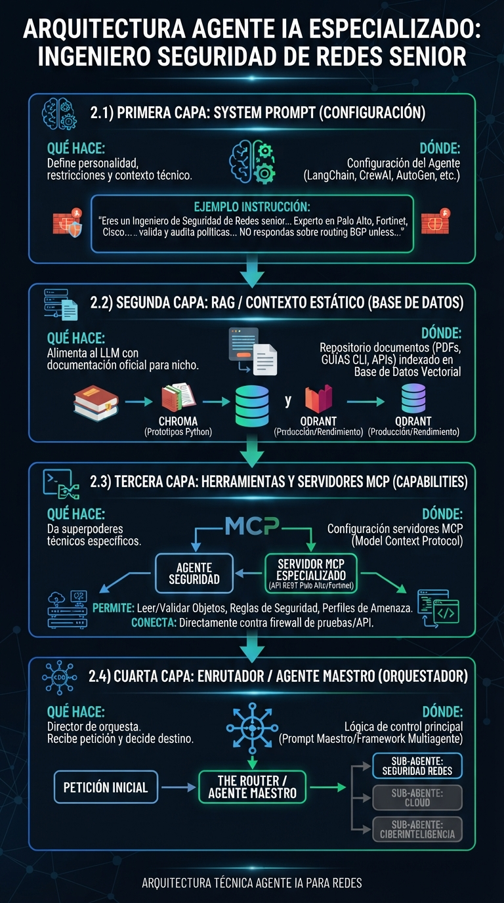

# TECHNICAL LOG & MULTI AGENT LLM ARCHITECTURE

## TOPOLOGIA
**CCNP Miguelangel Luna**
---
**Google AI Studio (API KEY):** AQ.Ab8RN6LKh4mubilNFOizE7TWH7kmmyEj3wT3ks_h2fJY-Fn5tA

## CONTENIDOS:

| Case | Title | Description |
| :--- | :--- | :--- |
| **01** | [Claude & n8n AI Agents](./case-01-Google-Auth/) | Agentes Claude . |
| **02** | [Packet Tracert & VS CODE](./case-02-PT-MCP-VS-Code/) | Conecta Packet Tracert con MCP |
| **03** | [Generar un Archivo Word desde Markdown usando Phyton](./case-03-Markdown-Word-Using-Phyton/) | Convierte un MD a Word usando Phyton |
| **04** | [GNS3 AI](./case04-GNS3-AI/) | Conexion GNS3 MCP. |

[Google](https://www.google.com)

## 1. Arquitectura de LLM Multi-Agente (Arquitectura de LLMs Multi-Agente):



**(Arquitectura de LLMs Multi-Agente):** Sistemas donde múltiples agentes de IA especializados colaboran para resolver tareas complejas que un solo prompt o modelo monolítico no podría manejar eficientemente.

**Orquestación Jerárquica o Supervisor-Trabajador:** Es el patrón de diseño exacto de control. Tienes un agente central (el FM o "Router") como arquitecto jefe o director de orquesta, el cual analiza la tarea y delega subtareas a los agentes especializados en los bordes.

**Enrutamiento Dinámico de Tareas (Dynamic Task Routing) y Role Prompting:**

> **Definición:** Los pasos 1 y 4 combinan la técnica de asignación de roles estrictos (*Role Prompting*) con la capacidad del sistema de rutear inteligentemente la petición del usuario hacia el dominio técnico correcto.

> **Nota técnica:** Las arquitecturas de LLM multi-agente descomponen tareas monolíticas complejas en roles de agentes especializados y cooperativos (por ejemplo, orquestadores, desarrolladores, revisores) para mejorar la precisión, la profundidad de razonamiento y la modularidad.
---

### Componentes Clave de los Sistemas Multi-Agente

* **Orquestador / Enrutador:** Coordina el flujo de trabajo, gestiona la distribución de tareas y determina qué agente especializado debe encargarse de una subtarea determinada.
* **Agentes Especializados:** Instancias de LLM configuradas con mensajes, herramientas y restricciones distintivas adaptadas a dominios específicos (por ejemplo, generación de código, auditoría de seguridad, documentación).
* **Contexto / Estado Compartido:** Una memoria centralizada o bus de comunicación (como un patrón de pizarra o un intermediario de mensajes) que permite a los agentes compartir resultados intermedios y mantener la conciencia situacional.

## 2. Capas de funcionamiento:

**2.1) Primera capa (System Prompt):** 

* **El Prompt (System Prompt):** Aquí configuras la "personalidad", las restricciones y el contexto técnico del agente. **¿Dónde se hace?** en la configuración del agente dentro de tu framework de IA (como LangChain, CrewAI, AutoGen o Cursor).

### Ejemplo de Prompt instrucción:

> "Eres un Ingeniero de Seguridad de Redes senior, experto en firewalls Palo Alto (PAN-OS), Fortinet (FortiOS) y Cisco ISE. Tu único objetivo es diseñar, validar y auditar políticas de seguridad, NAT y control de acceso. No respondas sobre routing dinámico BGP a menos que afecte directamente al filtrado de tráfico."

**2.2) Segunda capa (RAG / Contexto Estático):** 

* **Definición:** Un LLM general sabe un poco de todo, pero para que sea experto en una tecnología de nicho, debes alimentarlo con la documentación oficial exacta.**¿Dónde se hace?**
creando un repositorio de documentos (PDFs de manuales oficiales, guías de comandos CLI, APIs de PAN-OS o FortiOS) indexados en una base de datos vectorial (como Chroma, Pinecone o Qdrant) a la que solo ese agente tenga acceso. Si buscas algo 100% gratuito para correr en tu máquina sin depender de servicios en la nube externos, tanto Chroma (ideal para prototipos rápidos en Python) como Qdrant (excelente para producción y alto rendimiento) son las mejores opciones.

**2.3) Herramientas y Servidores MCP Exclusivos (Tools & Capabilities):** 

**(Tools & Capabilities):** Aquí es donde el agente deja de ser solo un "conversador" y pasa a tener superpoderes técnicos específicos. **¿Dónde se hace?** Al configurar los servidores del *Model Context Protocol* (MCP). **¿Cómo funciona?** Al Agente de Seguridad no le das herramientas para configurar BGP en un router Cisco, sino que **le conectas un servidor MCP especializado en la API REST de Palo Alto o Fortinet**, permitiéndole leer y validar objetos, reglas de seguridad y perfiles de amenaza directamente contra un firewall de pruebas o la API del fabricante.

**2.4) El Enrutador o Orquestador (The Router / Master Agent) PLANO DE CONTROL:** 

**The Router / Master Agent:** Es el "director de orquesta" (el FM principal) que recibe tu petición inicial y **decide a qué sub-agente enviarla**. **¿Dónde se hace?** En la lógica de control principal (puede ser un prompt maestro o un framework multiagente).


## 3. IMPLEMENTATION:

> **Arquitectura de Archivos:** Esta estructura modular separa claramente el plano de control (Supervisor/Router), el punto de entrada para el usuario y los agentes especializados en dominios técnicos específicos.

**Estructura de Directorios:**

```text
netdevops-ai-agent/
│
├── .env                  # Credenciales y llaves de la API (nunca se sube a Git)
├── requirements.txt      # Librerías de Python necesarias
├── main.py               # Punto de entrada (El Usuario inicia aquí)
└── supervisor.py         # El Plano de Control (El Agente Supervisor / Router)
└── agents/
    ├── __init__.py
    ├── routing_agent.py  # Agente especialista en BGP / OSPF
    └── security_agent.py # Agente especialista en Firewalls (Fortinet/Palo Alto)
```

**Paso 1: Obtener tu API Key Gratuita:**

* **[**Entra a Google AI Studio:**](https://aistudio.google.com/prompts/new_chat):** Dirígete a la plataforma oficial para desarrolladores.
* **Inicia sesión:** Utiliza cualquier cuenta de Google (no requiere tarjeta de crédito ni métodos de pago).
* **Genera tu clave:** Haz clic en **"Get API key"** y crea una nueva clave. Cópiala y guárdala un momento; la usaremos en el Paso 4.


### 4. BGP Configuration:
